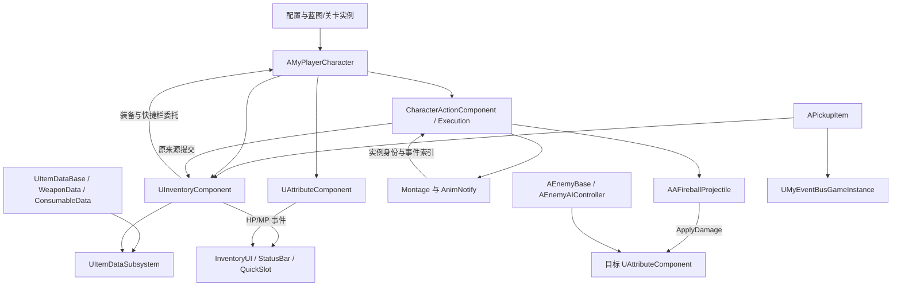

# 项目架构与运行入口

基线日期：2026-10-17。代码事实以 [IntroCpp.uproject](../IntroCpp.uproject)、[Build.cs](../Source/IntroCpp/IntroCpp.Build.cs)、[引擎配置](../Config/DefaultEngine.ini) 和系统实现为准。

## 项目边界

- UE 5.8，当前本机验证版本 5.8.3；Game、Editor 两个 Target，业务只有一个 Runtime 模块 `IntroCpp`。
- 自定义玩法围绕第三人称 `AMyPlayerCharacter`、物品/背包、武器连击、敌人和 Unreal UMG Widget 展开。
- `AIntroCppCharacter` 是模板第一人称基类；`Variant_Shooter` 和 `Variant_Horror` 是保留的独立模板玩法，仍参与同模块构建。
- 启用 GameplayAbilities 插件不等于自定义角色已经采用 GAS。当前属性、伤害和消耗品走项目组件与 ItemAction。
- 自定义链路未见完整 RPC、属性复制、SaveGame 或持久化存档实现。当前文档不承诺多人或重启后保存背包。

## 目录地图

| 位置 | 用途 |
| --- | --- |
| `Source/IntroCpp/` | 实际业务与模板 C++；UBT 构建入口 |
| `C++ Source/IntroCpp/` | 存在另一份 MyPlayerCharacter.cpp 参考副本；不参与当前模块编译，不作为修改入口 |
| `Content/MyStuff/` | 自定义关卡、蓝图、输入、UI、模型、动画 |
| `Content/Data/Items/` | 物品数据；含 Weapons 子目录 |
| `Content/Data/ComboData/` | 连击数据资产 |
| `Source/IntroCpp/Actions/`、`Content/Data/Actions/` | 动作调度、独立执行上下文、窗口/移动快照与样本定义 |
| `Content/Data/Enemys/` | 敌人数据；路径实际拼写是 Enemys |
| `Config/` | 启动关卡、GameInstance、默认 GameMode、输入、资产扫描等 |
| `Plugins/UE_MCP_Bridge/` | ue-mcp 1.4.7 原生编辑器插件；第三方工具 |
| `Tools/ue-mcp/` | 固定版本 Node 服务端、依赖锁、工具说明 |
| `Scripts/Tests/` | 编辑器 PIE 与 MCP 冒烟脚本 |
| `Saved/`、`Intermediate/`、`Binaries/` | 本机日志与生成产物，不作源码和永久技术记录 |

## 运行与蓝图入口

配置中的 EditorStartupMap、GameDefaultMap 都是 `/Game/MyStuff/Lvl_Start`；GameInstance 是 `UMyEventBusGameInstance`。`UUW_MainHUD::OnButton_StartGameClicked()` 按 `GameLevelName` 打开关卡，C++ 默认值为 `MyLevel`。

2026-10-19 已核实 `Lvl_Start` 的 Level Blueprint 在 BeginPlay 创建 `/Game/MyStuff/MyUI/UW_MainTitle_DarkFantasy`，随后 AddToViewport、显示鼠标并设置 UI Only 输入。该 Widget 继承 `UUW_MainHUD`，因此可继续复用开始按钮的关卡切换行为；旧 `/Game/MyStuff/MyUI/UW_MainHUD` 保留但当前不由开始关卡创建。

2026-10-17 编辑器只读核对结果：

| 核对项 | 实际值/含义 |
| --- | --- |
| 当前编辑器关卡 | `/Game/MyStuff/MyLevel`，当时 37 个编辑器 Actor |
| MyLevel 的世界 GameMode 覆盖 | `None`，即使用配置的全局默认值 |
| 全局 GameMode 蓝图的 DefaultPawnClass | `/Game/FirstPerson/Blueprints/BP_FirstPersonCharacter` |
| 自定义玩家蓝图 | `/Game/MyStuff/BP/BP_MyPlayer`，父类 MyPlayerCharacter |
| MyLevel 中放置的玩家 | `BP_MyPlayer1`，其关卡实例 `AutoPossessPlayer=Player0`；蓝图默认值是 Disabled |
| 旧玩家路径 `/Game/MyStuff/BP_MyPlayer` | ObjectRedirector，不能当作另一套有效玩家实现 |
| 敌人蓝图 | `/Game/MyStuff/BP/BP_Enemy_Dummy` 使用 `/Game/Data/Enemys/DA_Enemy_Dummy`；CDO 的 AIControllerClass 为 null |

因此修改默认 Pawn、场景玩家或控制器前，要同时核对 GameMode、关卡实例和蓝图默认值。此前 PIE 能运行不能推导“所有玩家都由自定义 GameMode 自动生成”，也不能推导“敌人的控制器配置已验证”。原始证据见 [快照](Reference/editor-observations.json)。

## 系统协作

箭头表示调用或依赖，不表示所有箭头均为事件驱动。事件参数与实际限制见 [接口契约](Interfaces.md)。

## 状态与生命周期归属

| 状态 | 归属与寿命 |
| --- | --- |
| 物品配置 | DataAsset；以 ItemID 查找，可能同步加载；不用于存放每个背包实例的数量 |
| 物品注册表/缓存 | GameInstanceSubsystem；跨关卡但非跨进程存档 |
| Inventory、QuickSlots、装备索引 | 角色的 InventoryComponent；角色销毁时结束 |
| HP/MP、死亡状态、恢复计时 | 各 Actor 的 AttributeComponent |
| 当前武器与手持表现 | MyPlayerCharacter；所有公开换装路径受Actions许可 |
| 动作、连击、缓冲、提交身份、物品来源预约 | CharacterActionComponent与每次执行UObject；死亡/EndPlay统一结束，不存档，无旧动作Timer |
| 敌人 AI 状态 | EnemyAIController 的 Tick 状态机；不是自定义敌人的 StateTree |
| 事件名称和跨系统订阅 | MyEventBusGameInstance；订阅方负责合适时机解绑 |
| UI 选中、拖拽、图标回调 | Widget；模型数据由组件持有，Widget 销毁不应承担持久化 |

## 模块依赖与扩展位置

Runtime 模块依赖 Core、CoreUObject、Engine、InputCore、EnhancedInput、AIModule、StateTreeModule、GameplayStateTreeModule、UMG、Slate、SlateCore。编辑器插件带来的依赖不应被业务代码误认为自身已声明的依赖。

优先扩展已有边界：物品配置放 DataAsset；消耗品效果放 UItemAction；属性变化放 AttributeComponent；敌人配置放 EnemyData；Widget 负责显示和输入转发。新增公共接口先记录返回值、失败副作用、事件和蓝图影响。尚未统一的存储与使用路径见 [已知问题](Known-Issues.md)。
