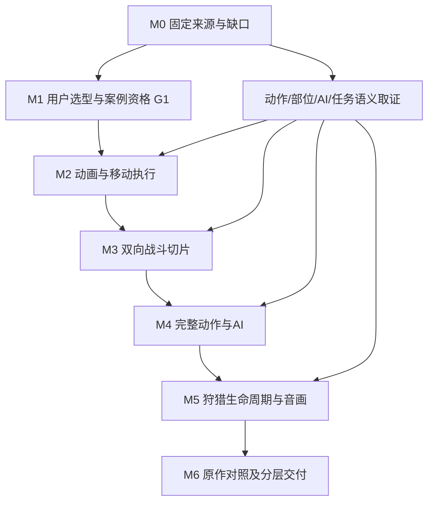

# PLAN-20261031-002：MHWI 普通雌火龙忠实还原总体方案

- 状态：in-progress；用户2026-10-31已采用推荐组合1C/2B/3B/4B/5A/6B/7B，首条链路实施中；完整还原未完成。
- 日期：2026-10-31。
- 用户需求：提出雌火龙还原总体方案，分派子代理编写各部分细化实现步骤，汇总流程；缺少数据时允许指挥子代理解包。
- 关联模块 / 接口 / 问题：`mhwi-unpack-data`、`mhwi-rathian-animation`、`mhwi-longsword`、`enemy-ai`；R-DATA-001/002/003/004、R-AI-001/002，以及既有太刀原生碰撞/伤害边界。
- 实施记录：[本次方案与取证记录](../Changes/CHG-20261031-002-rathian-restoration-plan.md)。此记录完成不代表本方案玩法已实现。

最新选型与进度：[ADR-0002](../Decisions/ADR-0002-mhwi-rathian-source-runtime.md)、[首条链路PLAN-007](PLAN-20261031-007-rathian-first-chain.md)。下文候选比较保留选型时的成本说明；原先“待用户选择/尚未实施”描述由本次明确选择及实装记录更新，不代表未闭合语义已通过。

## 现状与目标

目标是项目当前 MHWI 普通雌火龙 `em001/00`，不是 `em002` 火龙。首个验收配置采用下位单人；上位、大师位、体型和任务倍率随后按有来源的配置扩展。该默认范围来自项目现有目标与数据，不把用户泛称“怪物猎人”扩大成其它作品或历代混合招式。

需要还原的是动作选择条件、轨迹与转向、命中几何与时序、双方伤害/异常/反应、部位变化及完整狩猎生命周期。模型显示、动画可播放、可打掉血分别只是阶段结果。每一项原作等价主张必须有对应原始资源、消费者或运行证据。

### 证据等级与当前基线

| 等级 | 含义 | 能支持的结论 |
| --- | --- | --- |
| 官方机制 | Epic UE5.8 文档、API、项目使用的引擎源码 | UE 提供什么机制及其适用条件；不能证明 MHWI 原作行为 |
| 原始数据 | 固定游戏版本/归档/覆盖来源、相对路径、偏移、hash、原始字段 | 某字段/资源存在且可重复读取；不能自动证明运行语义 |
| 消费者证据 | 原生调用/条件/字段使用关系或有来源的解析实现 | 指定字段如何参与指定流程；未追到的分支保留未知 |
| 运行验证 | 指定版本、任务、装备、位置、状态及输入下可复核的原作与 UE 观测 | 仅证实实际覆盖的场景；历史报告不视为本轮执行 |
| 项目推断 / 拟议适配 | 本文候选、拟议接口和实验条件 | 方案或假设，不能提升成“原作已证”或“已实现” |

- 本轮主代理核查 `IntroCpp.uproject` 的 EngineAssociation=5.8；真实 UBT 入口在 `Source/`。Build.cs 已有 AIModule、StateTreeModule、GameplayStateTreeModule；GAS 插件启用但当前 Build.cs 没有 GameplayAbilities 依赖。
- 雌火龙源资源历史清单为 300 文件；证据子代理本轮复核 300/300 尺寸与 SHA256 一致，总计 80,708,036 B。THK×105/thklst 是怪物 AI 取证入口，不能套用太刀的 wp FSM 解释。
- [现有数据页](../Reference/MHWI-Rathian-LR-Data-20261030.md)有基础 HP、12 肉质组、7 硬直组及怒/疲劳/异常原字段；基础 HP=3000 不等于某任务实战 HP。肉质组号尚不能直接当命名部位。
- [格式证据](../Reference/MHWI-Rathian-Format-Evidence-20261030.md)已有 342 ACTP2 动作记录和 70 条 COL 攻击原记录；它们不等于 342 招、下位招式表或实战伤害表。PBC 已读结构不等于已知破坏耐久。
- [动画库](../Systems/MHWI-Rathian-Animations.md)历史导入 19 LMT 的 848 有效动作；旧24条[源时长修复](../Changes/CHG-20261031-001-rathian-legacy-duration.md)另有记录。848 条不能全作为战斗招式，空槽不制造动画；本轮未重跑导入/PIE。
- 历史资产根为 `/Game/MHWI/Rathalos`；雌火龙 Skeleton 为 `/Game/MHWI/Rathalos/Mesh/SK_EM001_Body_Skeleton`。保留历史目录与已存在引用；后续新运行资源的路径需另行核对。
- `AMHWICharacter::SweepWindow` 和延迟 shell 路径仍直接向目标 AttributeComponent 扣血；SweepWindow 用角色前方/两侧球扫、Actor 去重，未携带可用于肉质结算的 BoneName/PartId。怪物收伤组件与这两个玩家入口必须一起桥接，避免双扣。
- 旧 `EnemyAIController` 是 Patrol/Chase/Attack/Dead，且存在已登记的感知组件创建时机风险；Shooter 的 StateTree 不代表 MHWI 接通。不能把旧敌人子类直接当完整雌火龙。
- 本次另从归档定向补取73个外部音画/任务候选文件，共16,446,967 B（15.69 MiB），73/73复读尺寸/SHA一致；原资源仅在新Saved批次，详见[精简证据](../../Tools/MHW/rathian-plan-evidence-20261031.json)。它们仍为raw，不证明完整引用闭包。
- 子代理本轮 UE-MCP 状态为 `editorConnected=false`。本方案对资产类/骨架/时长的依据为磁盘、制作脚本和历史报告；未声称本轮重新读回编辑器实际属性。

## 范围与验收标准

按层交付，同时保留完整怪物还原的范围，不能把后期机制从总目标中消失。

| 层 | 内容 | 达标条件 |
| --- | --- | --- |
| L0 来源与资产 | 版本、原始/覆盖分离、模型材质、骨架、动作身份、坐标/时间 | 每条运行资源可回到源文件/槽号；来源未知项隔离 |
| L1 固定脚本战斗切片 | 一条已证地面动作、一个近战命中及一个火球/shell 代表案例 | 动作条件、根轨迹、攻击窗、单次结算、受击/死亡/清理成闭环；无来源案例不入选 |
| L2 完整本地战斗 | 各已证招式、连段、地空切换、怒/疲劳、双方肉质与异常、硬直/倒地、断尾/破坏、音画 | 完整招式清单逐条有资格/时序/空间/反应证据，开放项逐条列出 |
| L3 完整狩猎生命周期 | 搜索/失去目标、换区/回巢/进食/睡眠、陷阱/捕获、剥取/掉落/任务结束 | 由任务与世界依赖支撑，死亡和捕获终态互斥且结算一次 |
| L4 MHWI 扩展与环境交互 | 上位/MR profile、尺寸、投射器/闪光/音爆适用性、乘骑、飞翔爪/软化/全弹发射、环境陷阱、蛋/领地反应、争斗/其它怪物协同 | 先证实该雌火龙版本实际支持哪些行为，再补玩家能力及其它 Actor；不因单怪战斗完成宣称此层完成 |

候选行为清单包含咬击、冲撞、转尾、吐火、后空翻、起降、吼叫等用于安排取证的俗称；是否存在于首个 LR 配置、次数与连段条件，必须由证据工作包逐项确认。风压、震动、断尾后毒判定等不能按系列经验默认开启或删除。

当前目标以本地玩法为主；未提出多人同步与跨版本存档需求。新增时需重新评估状态同步及序列化，不用局部 `HasAuthority()` 判断宣称联网完成。

## 官方方案先行与候选技术方向

以下来源于本轮检索的 Epic UE5.8 文档或其 5.8 页面；页面不可直取时只采用检索可见结论，具体 API 在实施前再与 `E:/UE/UE_5.8/Engine/Source` 核对。

| 官方来源与版本 | 官方结论 | 项目推断 / 选择门 |
| --- | --- | --- |
| [StateTree Overview](https://dev.epicgames.com/documentation/unreal-engine/overview-of-state-tree-in-unreal-engine?lang=en-US)、[UE5.8 Release Notes](https://dev.epicgames.com/documentation/unreal-engine/unreal-engine-5-8-release-notes) | 分层状态与任务/转换可组织行为；5.8 有新的状态起点及编译能力 | 可承载雌火龙的高层行为，无法自动解释 THK；不得凭现有依赖即定案 |
| [Behavior Trees](https://dev.epicgames.com/documentation/en-us/unreal-engine/behavior-trees-in-unreal-engine)（UE5.8） | 黑板、任务、条件与事件驱动树提供另一套 AI 编排机制 | 适用条件和改造成本见 AI 子方案；不是原作 AI 等价证明 |
| [Data Assets](https://dev.epicgames.com/documentation/unreal-engine/data-assets-in-unreal-engine?application_version=5.8) | 系统数据可放 UDataAsset；Primary 增加 ID/bundle 和 Asset Manager 管理能力 | 数据形态与来源账本先约定需求；只有实际需要加载/cook管理才选择 Primary |
| [Locomotion](https://dev.epicgames.com/documentation/en-us/unreal-engine/locomotion-in-unreal-engine)、[Root Motion](https://dev.epicgames.com/documentation/en-us/unreal-engine/root-motion-in-unreal-engine)（UE5.8） | 动画根轨可驱动移动；运动扭曲可调整轨迹以适配目标 | 原轨保真与主动扭曲是不同选择，不能默认用 Motion Warping 改攻击距离 |
| [Traces](https://dev.epicgames.com/documentation/unreal-engine/traces-with-raycasts-in-unreal-engine)（UE5.8） | 支持对象/通道、单/多命中与多种查询形状 | 原始 COL 几何到骨骼/世界的映射仍需证据；球扫功能可用不证明还原完成 |
| [Automation Test Framework](https://dev.epicgames.com/documentation/en-us/unreal-engine/automation-test-framework-in-unreal-engine)（UE5.8） | 支持 API、功能、内容与截图等验证层 | 用独立原作基准验收，不能从生产配置反生成期望再宣称忠实 |

### 选型时的候选比较与证据门

Epic 没有“MHWI 雌火龙一键还原”的官方方案，原作 AI 语义也尚未全部读出。以下保留有出处的候选比较；**用户已采用1C/2B/3B/4B/5A/6B/7B，按ADR-0002开始首链实施**。原生语义不足的证据门继续保留，不重复请求同一选型。

| 决策 | 候选及代价 | 推荐的下一步，非定案 |
| --- | --- | --- |
| D1 AI 编排 | StateTree+C++：项目已有依赖，但需映射原作规则；BT+C++：工具成熟但有黑板/任务维护；THK/thklst 解释/重放：来源关系更直接，但指令、调用、随机与消费者语义尚未闭合，且没有 Epic 原作解释器 | 先交付规则账本与一个可比较行为，再选择；需要可维护的 UE 原生编排时优先评估 StateTree |
| D2 移动宿主 | Character/CharacterMovement：可复用地面/飞行模式及根运动接口，但大型骨架/胶囊限制需实测；Pawn+MovementComponent：几何与地空控制自由，需承担碰撞/斜坡/重力/导航适配 | 用同一动作原轨和地形作受控对照；不能仅凭体型选择自研 |
| D3 时间/位移 | UE 根运动 Montage、源轨提取后专用移动适配、混合方案均可评估；同时驱动会双位移，Motion Warping 会改变轨迹 | 先确认源根骨、单位、混合与原生位移消费者，再比较 |
| D4 命中与收伤 | 骨绑定查询体/连续 sweep、PhysicsAsset bodies、原生几何解释各有可观测性与成本；现有球扫/Actor 去重无法表达完整部位语义 | 先闭合一条源攻击体和一个受击部位，再选能复现它的 UE 机制 |
| D5 数据与依赖 | UDataAsset、表、原生结构快照；Primary/AssetManager、GAS、独立模块另有迁移与生命周期成本 | 先确定加载/反射/原作字段需求；不将启用插件当成迁移决定 |

用户选择已记录于ADR-0002。正式接口与资产制作随首链分批落地；来源/消费者尚未闭合的字段仍须取证，不能因已选架构提升为已验证。

## 技术方案：工作包与共同契约

### 子代理交付

| 工作包 | 负责人 | 细化文档 | 实施交付 |
| --- | --- | --- | --- |
| W1 原作证据/定向解包 | rathian_evidence | [003 数据管线](PLAN-20261031-003-rathian-evidence-pipeline.md) | 来源/hash、依赖图、THK/动作/碰撞/任务关联、缺口与补取结果 |
| W2 AI/地空/生态 | rathian_ai | [004 AI 与世界](PLAN-20261031-004-rathian-ai-world.md) | 候选对比、规则编译/适配步骤、状态生命周期及世界依赖 |
| W3 模型/动画/音画 | rathian_combat_animation | [005 动画与资源](PLAN-20261031-005-rathian-animation-assets.md) | 骨骼/时间/位移核验、播放与过渡、破坏外观、VFX/音频接入 |
| W4 战斗/收伤/部位 | rathian_combat_animation | [006 战斗集成](PLAN-20261031-006-rathian-combat-integration.md) | 双向命中、伤害/状态、部位破坏、太刀桥接与验证 |
| W5 集成/验收/总流程 | 主代理 | 本文 | 决策门、依赖与里程碑、回归矩阵、记录及未知项汇总 |

三个子代理实际独立完成方案与核查；这是当前 chat 内分工，不创建新 chat。W3/W4 由同一子代理维护以减少动画帧、命中窗与收伤语义不一致。

### 先约定跨工作包的语义，再定义最终类型

以下是拟议的契约需求，名称和签名未冻结；子方案中的类/结构同样为候选。实施前 W5 将名称合并为一份接口契约，不能各自创建重复权威。

| 契约 | 需要保留的数据/语义 | 唯一状态所有者及禁止事项 |
| --- | --- | --- |
| 来源与资格 | GameBuild/ExeHash、归档/覆盖、源路径/hash、Monster/Variant/Rank/Quest、raw offset、parser pin、证据等级 | 离线账本持有；unknown 必须与 0/false 分开，未确认 raw 不进入忠实模式生产数据 |
| 动作请求 | NativeActionId、THK引用、bank/slot、目标快照、状态条件、请求原因 | AI 只发意图；动作执行拥有 ActionRunId/代次和 Accepted/Rejected，Accepted 不等于命中 |
| 时间与位移 | 源帧/采样率、UE秒、播放倍率、循环次数、前后区间、根轨/移动模式 | 一个动作时间权威及一个位移消费者，显式保留有证据的子时钟/层时间换算；ABP/Notify不各开独立权威或定时器补发伤害 |
| 接触与结算 | 攻击ID/窗/命中代次、目标弱引用、Bone/Body/Part、空间接触、伤害类型、原记录 | 碰撞产出候选，收伤解析器唯一提交；去重范围由原作证据决定，不能默认每Actor永远仅一次 |
| 状态与反应 | HP、部位累计/破坏阶段、怒/疲劳/异常、受击反应及来源优先级 | 每类状态指定唯一组件持有并由统一状态宿主仲裁；AI/动画读快照，表现回调不能再扣血或累积 |
| 终止与发布 | Completed/Interrupted/Failed/Dead/Captured/OwnerEnded、RunId、事件代次 | 先失效授权/关闭窗，再停动画/移动并清理对象，最后发布表现；终态幂等且不响应旧回调 |

共同命名约定（拟议，正式反射签名仍待选型）：SourceProfile标识来源/等级/任务；EncounterGeneration隔离一轮场景/狩猎；ActionRunId是同一Actor当前动作的唯一执行身份；PlaybackGeneration区分其下的播放实例，LoopIteration区分循环，TargetSpawnId标识目标这一生命周期。子方案原称ExecutionId统一称ActionRunId，不另建第二计数器。ShellInstanceId独立标识已发射投射物；其是否在母动作或母体结束后继续生效必须依原作证据，不能一律清除或一律保留。

所有 UObject/Actor/Widget 写操作及事件发布按游戏线程；异步资产回调必须检查 owner、RunId、生命周期和 world。Montage 中断、动作切换、目标死亡/卸载及 EndPlay 必须收口。反射改动先编译，再审计蓝图父类与完整路径；拟议 `Source/IntroCpp/MHWI/Monsters/` 和 `/Game/MHWI/Rathian/` 是新入口候选，尚不存在。

## 接口与数据迁移

| 当前入口 | 当前行为 | 拟议目标/迁移顺序 | 调用方/蓝图影响 |
| --- | --- | --- | --- |
| 雌火龙历史导入资源 | 已有 Skeleton/AnimSequence，历史 Rathalos 路径 | 只读盘点与登记后引用；新建播放/动作资产走候选新入口，不批量改名 | 保留模型/动画及关卡现存用户修改；新 BP 父类/默认值实际读回 |
| SweepWindow / 延迟 shell | 直接 AttributeComponent 扣血，缺部位上下文 | 先引入可回退的结构化接触适配；支持新怪物时只走一个结算路径，旧训练靶继续原路径 | 正常刀击/登龙/居合/投射器分别检查，不能只改近战主路径 |
| 旧 EnemyBase/EnemyAIController | 简单敌人行为与独立已知风险 | 不以重写旧 AI 作为雌火龙开工前置；新入口选定后接感知与动作意图 | 若复用组件创建方式须整改并验证；不改其它模式敌人的玩法 |
| 原始 ACTP2/COL/THK/PBC | 字段及结构部分可读 | raw→关联→资格→语义→编译数据→UE；每一层保留来源，未证字段单独隔离 | 不直接批量灌入 DA 造成“全部已还原”的假象 |
| 玩家猎人/世界能力 | 太刀训练场已有有限能力 | 飞翔爪/乘骑/捕获道具等列依赖，按后续层补齐 | 具体输入/UI/道具接口待能力盘点，不在方案中谎称已有 |

当前未修改任何接口签名、反射类型、蓝图或正式配置；表中均为实施步骤候选。

## 实施步骤与依赖

### M0 固定基线与证据补齐（W1，已执行部分见 CHG）

1. 记录 `git status --short`，保护用户的源码、DataAsset、动画和训练地图修改；不 reset、不覆盖现有资产。
2. 固定归档合并覆盖顺序、EXE/build、第三方 parser/tool commit 与 hash。原生归档和本机 `nativePC` mod 覆盖分开标记，原作基准不能默用 mod 行为。
3. 复核当前300文件和动画清单；沿资源实际引用盘点外部 sound/efx/任务依赖。只补缺失文件到新隔离目录，核对本次集合/尺寸/hash及逐文件归档来源。
4. W1 产出动作关联表：THK/thklst节点→动作注册/ACTP2→LMT bank/slot→TIML/AT事件→COL/SHLP，另列rank/quest门控。不能通过字符串相似就标“已关联”。
5. 并行补受击部位/肉质映射、PBC消费者、任务倍率与异常/反应表；证据不足保留 unknown。

**通过门 G0**：基线可复现、原始与覆盖可区分、每项unknown有定位与下一证据；不要求为进入下一次选型会议先破解整个游戏。

### M1 选型和第一批案例资格（W1+W2+W3+W4+W5）

1. 依据 D1–D5 对照同一条证据充分的地面动作；比较编排、位移与碰撞代价，由用户选定影响首批的技术方向。
2. 冻结第一版共同契约与状态所有权。明确首批选哪些招式、LR资格及不确定项；没有来源的吐火/后空翻只能作为取证任务。
3. 整理新 C++/反射/蓝图/资产路径和依赖，建立功能 PLAN；选择长期结构再记录 ADR。
4. 为后续原作运行采样定义固定任务/装备/HP/怒态/距离/角度/帧率/是否mod，来源不足不造基准。

**通过门 G1**：方案选择、案例来源、接口及验收基准均能审阅；技术候选仍未选时停在此门，不擅自开始运行实现。

### M2 动画与移动执行骨架（W3，依赖 G1）

1. 在不改旧848条的前提下建立 bank/slot→UE asset映射；核验骨架父子、Armature额外根、单位、轴、scale、源帧与持续时间。
2. 先实现静止播放/结束/取消，再接一条地面位移与转身，保证 Actor 与骨架只有一次根位移消费。
3. 接最小动作请求/RunId/快照，创建新 BP/ABP/动作数据，实际读回父类、Skeleton、Montage片段与根运动属性。
4. 测目标失效、播放失败、打断、死亡与切图；禁用本批来源未闭合的 IK/warping 对比它是否扭曲原姿态。

**通过门 G2**：同一源动作能定位、播放、移动、转向及终止；时空误差按实测采样分辨率报告，不先编造“原版容差”。

### M3 双向战斗垂直切片（W4+W3，依赖 G2/相应来源）

1. 为雌火龙收伤解析指定唯一入口，先桥接 SweepWindow 与延迟 shell，区分接触/弹刀/伤害/异常等结果；保留训练靶回退。
2. 一个已证部位、一次猎人近战命中：解析几何与部位→肉质与公式→HP/部位累计→反应→表现；未证公式阶段输出 unavailable。
3. 一个怪物近战动作：动作区间→骨绑定攻击体→连续检测/去重→玩家防御/无敌/反击资格→伤害与反应。
4. 一个已证shell案例：出生骨/方向/时刻、轨迹/重力/速度、命中/爆炸/寿命及重复接触；同一火球不从碰撞和Notify重复扣血。
5. 覆盖空挥、一次/重复命中、多部位/多目标竞争、低帧跨窗、打断、目标消失与死亡；同时回归太刀气刃/见切/居合/登龙关键路径。

**通过门 G3**：来源、时序、空间和单次提交链全部有记录；固定脚本驱动的切片通过不代表 AI 或全招式完成。

### M4 行为与完整战斗（W2+W4+W3）

1. 接感知→目标资格→距离/角度/朝向→动作请求；执行器反馈完成/失败/打断，AI不直接操纵攻击窗。
2. 按规则账本接每条已证招式、冷却/连段、地空切换；先固定情境复现，再比完整决策分布。随机种子可用于UE重放，不能无证声称与原作随机序列等价。
3. 怒态、疲劳、耐力消耗/恢复与异常分开持有；组合状态、不可打断阶段及反应抢占按源证据，不写通用经验优先级。
4. 分别接硬直、倒地、头/翼等破坏和断尾外观/碰撞/肉质变化；PBC未知时不拿EPG硬直值当破坏耐久。
5. 地面Nav、台阶斜坡、遮挡、飞行/降落失败、失去目标及脱战回收专项验证。骨绑定命中体不替代导航胶囊。

**通过门 G4**：所有纳入的战斗动作逐条通过，范围与未实现招式显式列出；不能以“能打一场”覆盖未解机制。

### M5 完整狩猎与音画（W2+W3+W4）

1. 接换区、回巢、进食、睡眠及其世界锚点；原作地图拓扑与UE测试场差异单列。
2. 接陷阱、抗性递增、麻醉/捕获条件；死亡与捕获同时触发的冲突按已证规则裁决，不猜HP百分比。
3. 接部位外观、断尾残骸、剥取/掉落、捕获奖励及任务结束，交易与事件均仅一次。
4. 音效/特效按实际事件ID映射；建立源事件→UE Niagara/Audio候选适配。提取到了文件不等于已转成UE可用效果或包含完整音频bank依赖。
5. 补 L4 的已证 MHWI 行为；依赖未实现的玩家能力和其它怪物单独列开发包，不藏进本地AI。

**通过门 G5**：从生成至死亡/捕获和场景清理可重复完成狩猎；音画与机制分开验收，上位/MR不得复用LR参数冒充完成。

### M6 原作对照与收尾（W5 组织）

1. 按固定条件分别取得原作与UE轨迹/事件/状态记录；原作运行采样需定义具体动作及访问范围，未执行前保持“待运行验证”。
2. 每项报告来源身份、前后状态、输入、预期/实际与误差；动作帧、连续空间、伤害取整、随机决策分别比较。
3. 对照真实输入到决策、动作和结算的路径，不能只调用内部函数验证自己生成的数据。
4. 更新现状系统页、接口、modules.json、Known-Issues及分批CHG；每个条目分别标“已实现/静态发现/运行验证/待验证”。
5. 完整矩阵未通过时交付部分范围，保留unknown，不发布“完全还原”。

### 总流程与可并行边界

M0 中资产盘点、行为取证与参数关联可并行；G1后动画/执行器和纯数据规则可并行；共享的动作时钟、状态契约、伤害入口先合并。正式资产保存、构建以及同一个PIE世界的验证按依赖串行，不能多代理同时改同一地图/骨架/DA。

## 验证计划

以下是后续玩法计划，不是本轮已执行结果。当前方案实际检查见 CHG。

| 场景 | 方法/命令 | 期望结果 | 覆盖边界 |
| --- | --- | --- | --- |
| 当前文档交付 | `python Scripts/Docs/check_docs.py`、`git diff --check` | 引用/模块清单合法、无新增空白问题 | 不验证玩法或资产 |
| 来源与编译数据 | 固定原包/原字段独立基准、逐文件hash、引用链/roundtrip检查 | 来源变化拒绝、未知字段隔离、映射无歧义 | 不自动证明消费者语义 |
| 源码/反射 | `Docs/Development.md` 的 IntroCppEditor Win64 Development 构建；蓝图编译与读回 | 所选分支通过UBT/UHT及实际资产配置 | 仅在实施C++/反射后执行 |
| 动画/移动 | 原骨骼采样、Actor根轨、起终帧与位移/转向曲线，固定场景PIE | 对齐同一源动作；双位移/滑步/残留模式能被发现 | 视觉相似不能代替原作数值依据 |
| 命中/结算 | 固定部位/角度/动作/防御；0/1/多次命中、跨帧、反击/无敌、打断/死亡 | 单一结算入口、部位正确、未知公式不假完成 | 期望必须独立于生产配置 |
| 时钟压力 | 正常帧率及计划30/15/10 FPS、一次跨越完整窗、pause/速度变化 | 无漏窗/多扣/旧回调污染；按批准的源时钟对照 | 帧率为UE压力工况，不宣称原作运行基准 |
| AI/世界 | 不同距离/角度/可见性、怒疲劳组合、地空、导航失败、换区与目标消失 | 条件/分支/恢复符合有来源规则，失败路径可解释 | 固定脚本重放与自主AI单列 |
| 原作等价 | 固定无mod配置的原作观测 + UE同条件记录 | 每条行为独立判定，误差有采样依据，未覆盖明确 | 不能用一次完整狩猎代替全矩阵 |
| 猎人回归 | 针对本批桥接的普通攻击/气刃/见切/居合/登龙延迟段及生命周期 | 保持原已验证范围；现有待验项不自动升级 | 不无条件重跑全工程或旧过期夹具 |
| 烘焙/资源加载 | 依最终软引用/AssetManager方案做定向打包加载 | 正式使用资源进包、异步失败安全、未强载848动画 | 框架选择后再确定命令 |

## 风险与回退

- 证据不足的主要风险是“能运行”掩盖原作语义未闭合；按字段/行为保留unknown和资格门，不拿系列常识补数值。
- 同名文件、`00`目录、`fs`库或日文招式名不能单独证明LR资格、变体或实际用途。旧参考页有历史命名混杂，本文优先使用已核实em001身份及源ID。
- 848动画一次强加载、逐骨每帧大量查询体、复杂材质/特效均可能有性能成本；先按实际动作/依赖加载，性能目标基于固定硬件与场景实测后定义。
- 当前源码/资产有大量已有未提交修改。本轮只新增方案/精简证据与必要索引记录；实施每批另作文件/资产级备份与hash保护。
- 代码/接口按单批差异回退；新增运行入口可解除测试关卡引用，旧资源保持可用。资源备份恢复需防编辑器缓存覆盖，不可 `git reset --hard` 或回退整个训练地图。
- 本次定向提取输出位于新的Saved批次；撤回时仅移除准确列出的本次产物和文档行，不清理旧解包目录/原包/用户资料。
- 当前REA/Ghidra深度provider条件由证据工作包记录；工具缺配置只表示本轮未执行相应消费者逆向，不当成数据永久不可解。新增解析/逆向路线仍遵守“有出处候选→用户选择→执行”。

## 文档同步清单

本次新增主方案及四份子方案、独立取证摘要和CHG；更新 Docs 首页、Plans 与 Changes 索引、解包现状的本轮补取说明、Known-Issues的R-DATA-004，并为现有解包模块增加精简证据入口。接口和模块不因拟议运行系统而提前写成已实现；现有模块仍负责定位真实代码/动画/解包入口。

后续每一实装批次按实际影响更新 Combat-AI、MHWI-LongSword、雌火龙新现状页、Interfaces、modules.json、Known-Issues及新CHG；已完成历史记录保留原义。本次不新增已选型ADR。
