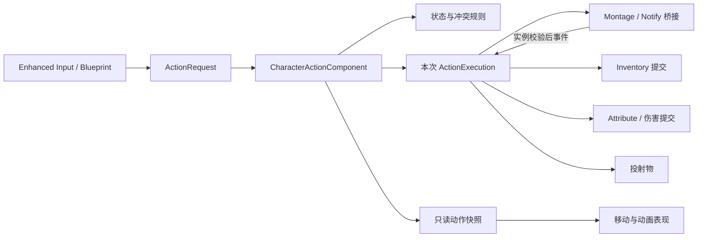
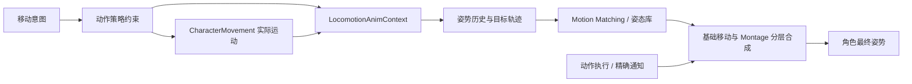

# PLAN-20261019-003：角色动作管理重构

- 状态：partial，2026-10-19 动作调度、三类执行、连击窗口和物品事务已实施；MM按用户要求待动画资源后继续
- 日期：2026-10-19
- 用户需求：评估当前项目动作管理并给出重构方案。
- 关联模块 / 接口：player-combat、inventory、attributes、ui-input；`COMBAT-001..006`、`INV-004/010..014`、`ITEM-004`、`EVT-ATTR-02`
- 关联问题：`R-COMBAT-001/002/003/004/005`、`R-INV-004/005`
- 本次交付记录：[CHG-20261019-003](../Changes/CHG-20261019-003-action-refactor-proposal.md)，仅记录分析和文档；不代表实施完成。
- 后续方案扩展：[CHG-20261019-004](../Changes/CHG-20261019-004-motion-matching-plan.md)，按用户要求加入 Motion Matching，仍未实施。
- 实施事实：[CHG-20261019-005](../Changes/CHG-20261019-005-character-actions-implementation.md)；下文保留原方案与基线含义，现状以系统页和本记录为准。MM正式接入按用户本轮指示暂缓，资源需求见 [清单](MM-RootMotion-Resource-Checklist.md)。

## 结论与范围

建议采用 **统一动作调度组件 + 每次执行独立上下文 + 动画事件驱动 + 有限输入缓冲**。先迁移当前长剑、火球、喝药与换装；移动继续由 CharacterMovement 实现，动画蓝图负责表现。重构的首要目标是统一规则和生命周期，再调整操作手感。

本方案的“动作”指玩家攻击、施法、使用物品、换装，以及受击/死亡带来的打断。翻滚、格挡、蓄力仅作为后续扩展点，资产目录中存在动画文件不代表这些玩法已接通。敌人 AI 决策、模板 Shooter/Horror、联网与完整背包所有权迁移不纳入首期。

建议首期使用轻量 C++ 组件。当前是本地玩法，源码尚无 ASC、AttributeSet、GameplayAbility，Build.cs 也未声明 GameplayAbilities/GameplayTags/GameplayTasks 依赖。uproject 启用 GameplayAbilities 插件不能视为 GAS 已落地。如果近期明确要做联网预测、大规模技能/Buff/装备授予能力，应在开始实施前改选 GAS 路线，避免做完自定义系统再立即迁移。

按用户后续要求，增加 **Motion Matching 移动表现层**：P0 进行动画数据审计，P1 接口稳定后可在独立测试角色做原型，P5 验收后接入正式角色。它与动作调度、Montage 结算协作，不承担动作许可或物品/伤害提交。

## 现状与证据

以下源码为 2026-10-19 静态核查；资产为同日 UE-MCP 只读查询，未保存任何资产。缺陷风险尚未逐项通过 PIE 复现。

| 现状 | 代码证据 | 对重构的要求 |
| --- | --- | --- |
| 输入、武器外观、单次攻击、连击、使用物品和判定集中在一个约 1705 行的角色实现 | [MyPlayerCharacter.cpp](../../Source/IntroCpp/MyPlayerCharacter.cpp)；入口 461、489、682、710、833、1097、1226、1330 行 | Character 保留输入、移动和兼容入口；动作调度和动作执行分离 |
| 攻击会检查使用状态，使用入口却不统一检查攻击；直接 BlueprintCallable 入口可绕过输入层限制 | 同文件 `AttackStarted` 461、`UseItemStarted` 473、`UseHeldItem` 489、`Attack` 682 行 | 所有输入/蓝图/API 请求通过同一许可函数 |
| 移动禁止攻击/喝药期间输入，跳跃只检查背包 | 同文件 `Move` 154、`JumpStart` 197 行 | 移动、转向、跳跃分别配置，不用一个攻击布尔隐式决定 |
| 单次攻击用 max(冷却,动画时长) 的 Timer 清 bIsAttacking | 同文件 `PlaySingleAttack` 1330 行 | 冷却与动作占用独立，移动锁不能由冷却时长决定 |
| 窗口前输入丢弃；窗口内立即跳下一 Section；缓冲布尔从未置 true 或消费，HitWindowEnd 未参与关闭 | 同文件 `TryComboAttack` 1226、`ExecuteBufferedCombo` 1255；[ComboAttackData.h](../../Source/IntroCpp/ComboAttackData.h) | 分开输入缓冲、连招衔接和伤害窗口，删除两套连击推进路径 |
| 名为 Ended 的连击函数实际绑定在 BlendingOut 上 | 同文件 1571–1576、1682 行 | 明确提交、逻辑结束、BlendOut、Ended 四种事件 |
| 使用动作只保留旧 ItemData 和快捷栏索引，成功播放后只等通知，没有结束/中断兜底 | 同文件 `UseHeldItem` 489、`OnUseItemAnimFinished` 557 行 | 一次执行一个句柄；取消、缺通知、死亡、销毁均能结束 |
| 完成时读槽内新 ItemID，部分分支却执行开始时旧 ItemData；还会按同 ID 找背包并同步扣快捷栏 | 同文件 `ExecuteItemUseEffect` 579、`ExecuteItemActions` 633 行 | 记录来源容器与版本，从原来源提交，不按 ID 临时换来源 |
| Notify 丢弃 Animation/EventReference，只把 Owner 强转角色后调用无参数入口 | [AnimNotify_MeleeHit.cpp](../../Source/IntroCpp/AnimNotify_MeleeHit.cpp)、[AnimNotify_Fireball.cpp](../../Source/IntroCpp/AnimNotify_Fireball.cpp)、[AnimNotify_UseItemComplete.cpp](../../Source/IntroCpp/AnimNotify_UseItemComplete.cpp) | 绑定本次动作和本次 Montage 实例，旧/重复通知不能结算 |
| 死亡/受击没有在玩家 C++ 中订阅到动作；EndPlay 未显式清理动作 Timer、pending 和动画回调 | 同文件 `BeginPlay` 58、`EndPlay` 380 行；完整蓝图补充尚未逐图核查 | 强制终止和清理是组件职责，不能依赖动画自然播放到结束 |

### 已核查资产

| 完整路径 | 只读实际值 | 迁移策略 |
| --- | --- | --- |
| `/Game/MyStuff/BP/BP_MyPlayer` | IA_Attack=`/Game/MyStuff/MyInput/IA_Attack`；IA_UseItem=`/Game/MyStuff/MyInput/IA_Use`；AttackMontageMap 的 LongSword 指向 M_LongSwordAttack | 复用输入资产，迁移 C++ 转发，不按注释另建重复 InputAction |
| `/Game/Data/Items/Weapons/DA_WP_LongSword` | ItemID=LongSword；OverrideAttackMontage=M_LongSwordAttack；MeleeComboData=DA_LongSwordComboData | 第一轮通过适配器读取，暂不改名或删除旧字段 |
| `/Game/Data/ComboData/DA_LongSwordComboData` | 4 段 Combo01/02/03/04，引用 `/Game/MyStuff/Model/Robot/M_LongSwordAttack` | 保留 4 段和既有伤害数据 |
| `/Game/MyStuff/Model/Robot/M_LongSwordAttack` | 长 7s、RateScale=1、Slot=Attack；Section 从 0/1.583333/3/4.933333s 开始，Next 均 None；6 个 MeleeHit，无 NotifyState | 保留 6 个显式 HitEventID，不能粗暴改成每段只结算一次 |
| `/Game/Data/Items/Weapons/DA_WP_FireStaff` | ItemID=WP_FireStaff；耗蓝 10；冷却 0.5s；OverrideAttackMontage=M_Attack_Fireball | 固定本次武器和数值上下文，不在通知帧再读取另一把武器 |
| `/Game/MyStuff/Model/Robot/M_Attack_Fireball` | 长 2.2s、RateScale=1、Slot=UpperBodyOnly；Fireball 在 0.588718s，无 NotifyState | 对应一次 Cast.Commit，而非直接调用任意时刻可发射的函数 |
| `/Game/Data/Items/DA_HP_Potion`、`/Game/Data/Items/DA_MP_Potion` | ItemID=Potion_HP/Potion_MP；均引用 `/Game/MyStuff/Model/Robot/M_Drink` | 两种配置共用使用动作执行器 |
| `/Game/MyStuff/Model/Robot/M_Drink` | 长 3.5s、RateScale=2、Slot=UpperBodyOnly；UseItemComplete 在资产时间 2.402629s，无 NotifyState | 按动画播放位置驱动生效；不能把资产秒数直接当世界 Timer 秒数 |

MCP 对 ComboData.WeaponAnimType 曾返回 `(INVALID)`，与其他工具的枚举导出方式可能有关；本方案不据此断言资产损坏。实施前用枚举数值/编辑器属性再次确认。ABP 内部完整 Slot 链、蓝图对旧函数的所有引用、玩家死亡蓝图补充仍待实施阶段资产审计。

## 技术方案

### 职责和文件落点（均为拟新增）

| 对象 | 职责 | 不承担的职责 |
| --- | --- | --- |
| `Actions/UCharacterActionComponent` | 接收请求、统一许可、冲突裁决、持有当前执行、缓冲与冷却、发布只读快照 | 不实现所有伤害、物品和外观逻辑 |
| `Actions/UCharacterActionDefinition` | 动作 ID、类型、Montage/Section、成本、冷却键、阶段移动策略、允许的取消类别 | 不存角色私有的计时、命中名单或槽位 |
| `Actions/UCharacterActionExecution` 及 Melee/Cast/UseItem 执行器 | 每次启动一个实例；持有上下文、效果账本、预约令牌和清理句柄 | 不决定其他动作能否启动 |
| 动画桥接器（先作上述组件内部 helper） | 播放、保存 MontageInstanceID，校验 Notify 来源、转发 BlendOut/Ended | 不自行扣血、扣蓝或消耗物品 |
| 现有 InventoryComponent / AttributeComponent | 持有物品和属性；增加动作所需的明确提交接口 | 不再通过角色布尔隐式管理动作 |
| MyPlayerCharacter / MyAnimInstance / ABP | 输入转成请求；按动作策略控制移动；读取动作快照并播放表现 | 不并行写入另一套权威攻击/使用状态 |

首期只引入一个调度组件、一个定义类型和三类执行器；不为每个按键新增 ActorComponent，不另建能重复设置状态的全局 EventBus。装备外观先保留原函数，由调度器控制调用时机，稳定后再考虑提取。

### 单一生命周期

`Pending → Windup → Active → Recovery → Finished`；取消和失败从任一非终态进入 `Finished(Reason)`。Idle 表示组件没有前台动作；Dead、Stunned、UIOpen 是外部限制状态，不与动作阶段拼成巨型枚举。

- **Pending**：同步预检和资源就绪检查，不占用前台，不扣资源。首期资源在装备/预热阶段加载；尚未就绪返回 Rejected(NotReady)，加载完成不会自动执行先前攻击输入。未来如需异步动作请求，必须另增 PendingLoad 返回值、最多一条可取消请求、请求版本和失效策略，不能偷偷沿用 Started/Buffered。
- **Windup**：动作已获得前台占用，保存武器/物品/配置快照与预约令牌，等待生效事件。
- **Active**：允许指定命中或提交事件。一个动作可以有多个明确编号的命中，但施法/物品提交只能成功一次。
- **Recovery**：效果已经生效，按配置恢复移动或允许衔接，冷却可以继续存在。
- **Finished**：统一清理。`Completed / Cancelled / Interrupted / Failed / OwnerEnded` 是结果，不再用“中断 bool”表达所有终止语义。

每个执行由组件使用 GC 可见的 `TObjectPtr` 持有，包含单调递增 `ActionRunId`、阶段、输入序号、来源快照、Montage 实例 ID、阶段版本、已处理事件和持有的限制令牌。连续连击链共享一个 RunId，每次进入段落（含循环回同段）都分配新 SegmentGeneration。DataAsset 是只读定义，Notify UObject 可能共享，二者都不能保存每次角色执行状态。

`FinishAction` 对同一个 RunId 最多生效一次：先标记终态、拒收旧事件，再关闭所有窗口、释放未提交预约、清理显式 Timer/委托、释放本次动作拥有的移动/转向限制，最后广播结束。StopMontage 可能同步触发回调，所以必须先失效旧 RunId；新动作只在本轮清理及事件派发后启动，避免重入。

BlendOut 负责关闭伤害与衔接窗口；逻辑能否结束由定义的 Release 点决定，默认自然结束在 Ended 完成。取消可立刻释放游戏逻辑占用，视觉继续短暂淡出，但淡出的旧实例不再有伤害权限。Timer 只用作输入过期、冷却或缺事件兜底，不再用它代替动画阶段。

### 冲突、输入与移动规则

第一轮只允许一个前台动作。移动/视角不是前台动作；不提前实现多通道并发。建议默认策略如下，均为方案参数而非当前已实现行为：

| 当前状态 / 新请求 | Attack | UseItem | SwitchEquipment | UIOpen | Death / ForcedStop |
| --- | --- | --- | --- | --- | --- |
| 空闲且存活 | 启动 | 启动 | 提交切换 | 打开 | 进入终止限制 |
| 攻击前摇/生效期 | 缓冲一次，等衔接窗口 | 拒绝 Busy | 拒绝 Busy | 拒绝 Busy | 强制取消 |
| 攻击后摇且有对应取消窗口 | 在链路点消费下一击 | 首期拒绝，避免自动喝药 | 在允许的窗口切换，否则拒绝 | 拒绝 Busy | 强制取消 |
| 使用物品前摇/生效/后摇 | 拒绝 Busy | 拒绝重复 | 拒绝 Busy | 拒绝 Busy | 强制取消；是否已提交分别处理 |
| UI 打开 | 拒绝 UIBlocked | 拒绝 UIBlocked | 仅按 UI 装备操作规则处理 | 关闭 UI | 强制结束 |
| 死亡 | 拒绝 Dead | 拒绝 Dead | 拒绝 Dead | 仅允许死亡菜单 | 重复终止幂等 |

受击不等于每次都硬直。只有明确产生硬直/击倒的结果才发强制中断；普通扣血不自动取消所有动作。死亡和 EndPlay 始终可终止，不能被“不可取消”配置阻止。

输入缓冲首期只接收攻击 Pressed：单条命令含输入序号、请求时间、有效期、候选下一段。初始可调有效期建议 150ms（手感调参起点），过期立即丢弃，消费后不再复用；连点最多保持一条待执行命令，不积累一整套自动连招。动作结束、UI 开启、死亡和武器切换会清掉不适用的缓冲。UseItem 不排队，避免意外喝药；Charge/释放输入留待后续动作定义。

移动策略分 MoveScale、FacingPolicy、AllowJump 三项。首期保留现有攻击/喝药禁止主动位移的体验作为基线，补齐跳跃许可；相机观察可独立允许，角色转向由阶段配置限速或锁定。击退和 Root Motion 不通过禁用 CharacterMovement 一刀切；动作限制按 RunId 释放，旧动作不能解开新动作的锁。

冷却由 `CooldownKey + ExpiryTime` 持有，和前台占用分开。切武器不能清除同一冷却键；正常在效果提交时开始冷却，未提交的播放失败不进入完整冷却。确需启动即冷却的动作必须显式配置。

### 动画时序和事件身份

分清四类资产事件，首期不同时改成长持续武器轨迹判定：

1. `HitEvent(HitEventID)`：一次明确的球扫；当前长剑保留 6 个命中点，按 Section 内事件配置对应伤害。去重键为 `(RunId, SegmentGeneration, HitEventID, Target)`，允许同一动作不同 HitEvent 多次伤害同一敌人，也允许明确的循环段重新结算。
2. `Commit`：火球生成或物品使用的生效点；每 RunId 仅成功提交一次。
3. `ChainWindow`：允许消费已缓冲攻击并衔接下一段。窗口范围由 NotifyState 表达，选定的链路点不应跳过尚未发生的命中。
4. `CancelWindow`：允许哪些类别取消/切换；不能和连招窗口混用。取消时组件主动关闭，不依赖 NotifyEnd 必定到达。

第一轮旧 Timer 时序经适配器维持，迁移到 NotifyState 后停用旧 HitWindowStart/End 的运行时权威；不会永久保留两套时钟。窗口依赖 Montage 的播放位置，因此能随 RateScale、暂停和播放速度变化。段落切换增加 SegmentGeneration，避免同一个 Montage 实例中上一段的迟到通知结算到下一段。

动画事件必须附带 Mesh、来源动画、MontageInstanceID、Section/事件标识，再由桥接器映射到 RunId；绝不能收到一个无身份通知后直接套用“当前动作 ID”。UE 5.8 的 `FAnimNotifyEventReference` 支持 `FAnimNotifyMontageInstanceContext`，原生 PlayMontageCallbackProxy 也按 MontageInstanceID 过滤通知，已核查本机引擎源码。无法取得可靠实例身份的旧蓝图回调只允许走经过登记的迁移适配器；缺失身份拒绝结算并给出诊断。

MontageInstanceID 不能天然区分同一次播放中的跳段代次。新事件资产配置固定 SourceSection/HitEventID，桥接层在动画更新批次边界登记其所属段代次、入队时复制该来源；动作推进在本批事件处理完后执行，禁止在 Notify 回调中立即跳段再把其余排队事件套入新段。无法证明来源的迟到事件拒绝；不能在接收时填当前 SegmentGeneration 充当身份。该批次边界与 UE5.8 动画任务顺序需在 P0 做小型技术验证，尤其覆盖同实例回跳、循环和一次更新跨越多个通知；如无法可靠标定，先采用每段新播放实例的保守方案并评估 Blend，再推进原实例无缝跳段。

每个 Timer/加载回调也捕获并校验 RunId 和阶段版本。动画数据缺失、Section/Slot 错误或播放失败时，结束为 Failed 并释放占用。缺提交事件以 Failed(MissingCommit) 结束且不扣资源；已经提交但缺阶段/Release事件，关闭权限并结束或报告降级，绝不补发效果或退款。Ended 保证最终清理；若 Ended 也缺失，看门狗按有效动画进度、暂停状态和速率判断无进展，并设独立可配置最大占用上限，不能直接拿资产时长作世界 Timer。看门狗只终止和释放，不补发命中/喝药，也不静默切回旧逻辑再次产生效果。

### 物品、耗蓝和伤害的提交边界

**物品来源**：首期承认当前 Inventory 与 QuickSlots 是两份独立存储，不顺手重写所有快捷栏。请求保存 `ContainerKind + SlotIndex + ExpectedItemID + SlotRevision + Quantity + ReservationId`。槽内容/数量/位置变化递增版本；预约期间对该槽的移动/丢弃/排序写入统一拒绝，强制操作先取消对应动作并解除预约。所有 UI 和 API 走同一后端校验，不能只挡数字热键。

**提交**：来源校验 → 效果预检 → 提交内置效果与数量 → 发布事件。取消发生在提交前，不扣物品/耗蓝；提交后被打断，不把已恢复的生命或已发射的投射物当作未发生并退款。执行效果、消费和动作结束是三种不同结果，接口不得再用一个 bool 混淆。

**兼容 ItemAction**：当前 BlueprintNativeEvent 可以有任意外部副作用，无法声称通用自动回滚。第一轮仅保证内置 Heal/RestoreMana 在同一游戏线程预检和提交、事件延后至状态一致后发布；旧自定义 Action 经显式 Legacy 适配器报告 Applied/Consumed/Partial，不能把 false 当成“什么也没发生”。多 Action 组合须约定消费一次和部分成功策略，不能先执行一半再假装原子失败。

**火球**：启动时快照武器、耗蓝与投射物配置，预检并预约可用 MP；提交点重新核验，通过 Deferred Spawn 在激活前写入 Owner/Instigator、伤害和方向，提交成功后扣蓝并启用投射物。初始化失败销毁未激活投射物并释放预约；当前日志中的 WeaponDamageOverride 应在此次迁移中变成真实初始化值。`UseMana(void)` 改由新 TrySpend/Reserve 接口包装，不假装它已有不足失败结果。

**近战**：首期沿用当前球扫规则和每事件伤害；是否改为多目标扫掠、武器 Socket 轨迹和团队过滤是后续命中系统议题。先解决重复事件、错误动作上下文和多段判重，避免同时改变命中体感后无法归因。

### Motion Matching：移动表现层扩展（2026-10-19，方案中）

#### 是什么，以及解决什么

Motion Matching（运动匹配）根据当前姿势、骨骼位置/速度和期望移动轨迹，在预先建立索引的动画数据库中选择合适片段并衔接。它使用现有动画数据，不自动生成缺失的动作。UE5.8 的实现位于 Pose Search 插件，主要资产为 Pose Search Schema 和 Database；官方 Game Animation Sample 可作为搭建与调试参考。

例如向前跑时突然要求向后移动：数据库覆盖充足时，可选到合适的减速、转身与重新起步片段，而不只是把前跑循环插值到后跑。具体改善幅度仍取决于动画覆盖、轨迹预测、权重和混合调参。

| 系统 | 本方案职责 |
| --- | --- |
| CharacterActionComponent | 决定能否攻击/喝药、前后摇、取消、移动限制和效果提交 |
| CharacterMovement | 首期继续负责胶囊移动、速度、加速度和碰撞 |
| Motion Matching | 在允许的移动状态/姿态库内选择走、跑、起停、转向动画 |
| Montage + 动画桥接 | 播放需精确结算的攻击/施法/喝药，并保持 RunId 和通知身份 |
| Animation/Motion Warping（后续可选） | 按具体需要修正步幅、朝向或动作目标对齐；不视为 MM 自动解决滑步 |

Motion Matching 不要求使用 GAS；本地轻量动作组件也能向其提供移动策略和姿态条件。首期不把六个近战命中或喝药 Commit 随机放进开放的搜索库，避免搜索切换影响必须发生的结算事件。

#### 当前项目条件：已查与未查

- 已发现 `/Game/MyStuff/Model/Robot/ABP_Move` 文件，以及 SwordAnim 下的 Idle、Walk/Run Loop、Run Start/Stop、Turn 等候选序列。文件存在不等于骨架兼容、方向覆盖和曲线已满足要求。
- 同日 UE-MCP 只读抽查以下 6 条序列，均读取成功、60 FPS、`rootMotionEnabled=false`：`/Game/MyStuff/Model/Robot/SwordAnim/Idle_Seq_YBot`、`Walk_Loop_F_0_Seq_YBot`、`Run_Loop_F_0_Seq_YBot`、`Run_Start_F_0_Seq_YBot`、`Run_Stop_F_0_Seq_YBot`、`Turn_180_R_Seq_YBot`（后五条与首条同目录）。
- 本机 UE5.8 安装包含 PoseSearch 插件，其描述为动画姿势索引和查询框架；`IntroCpp.uproject` 未显式列出 PoseSearch。这里只确认安装文件和项目配置，未宣称当前编辑器已经启用或接通 MM。
- 尚未核查实际 Root Bone 位移/朝向、Skeleton、重定向、脚部骨骼和脚掌接地信息。根运动开关关闭不等于源动画没有根轨迹；打开开关也不会凭空生成缺失轨迹。官方移动示例要求动画含 Root Motion 并启用相关设置，需先验证这些数据再按原型结果配置。

#### 接入设计

1. **单姿态试点。** 先从资源较多的长剑移动姿态挑选一致骨架的 Idle、走跑、起步、刹停、90/180度转向；跳跃/落地沿用现有分支。核对每条动画的根轨迹、速度尺度、循环边界和脚步；缺失方向/急转片段先记为数据缺口，不靠扩大搜索范围掩盖。
2. **独立资产。** 拟在 `/Game/MyStuff/Animation/MotionMatching` 创建 `PSS_PlayerLocomotion`、`PSD_Player_LongSword`、`ABP_Move_MM_Test`。这些路径为候选，当前未创建。先用复制测试角色验证，保持原 ABP 可恢复；通过后再扩展 Neutral/Staff 数据库。
3. **输入契约。** 从游戏线程生成不可变 `FLocomotionAnimContext`，含实际 Velocity、Acceleration、MovementMode、经动作约束后的 DesiredVelocity/DesiredFacing、Stance、MovementPolicy 和快照版本。长度/速度采用 UE cm、cm/s，轨迹时间偏移使用秒。AnimGraph 更新只读取快照，不从动画工作线程改动作或 Inventory。
4. **轨迹与骨架。** 优先验证 UE5.8 Pose History 节点的轨迹生成功能是否足够，再决定是否增加专用轨迹组件，避免同时维护两份预测。Schema 的 Root、左右脚骨骼按当前角色实际 Skeleton 选取，不直接照搬 Mannequin 的 foot_l/foot_r；先采用必要的姿势/轨迹特征，再测量是否需要更多通道。
5. **先过滤，再搜索。** 依据 Stance、地面/空中和动作限制选择允许的 Database 集合；足够后才考虑用 Chooser 整理复杂规则。攻击禁止移动时，预测必须反映受限目标和实际刹停状态，不能仍按被拦截的原始方向键预测奔跑。
6. **位移权威。** 首期继续由 CharacterMovement 控制基础位移。动画根轨迹用于搜索数据，不自动表示由 Root Motion 驱动胶囊；RootMotionMode、Root Lock 和必要的视觉偏移在原型中确定。动作 Montage 的 Root Motion 若启用，必须经过动作策略统一接管，禁止与基础移动重复累计或每帧争夺朝向。
7. **与 Montage 合成。** MM 输出基础 Locomotion Pose；长剑 Attack 全身层接管期间，不让基础移动覆盖动作姿势；火球/喝药的 UpperBodyOnly 按实际骨骼遮罩叠加，并继续遵守动作移动规则。新增 MM 不自动允许边走边喝药。结束/中断后平滑返回移动；Pose History 采样位置和返回搜索的姿势污染需在全身动作回归中验证。
8. **结算权限隔离。** 动作生效仍以执行句柄和动画实例校验；MM 搜索切片不获得伤害/喝药权限。移动库只保留脚步等表现通知，并检查重复脚步；数据库不得混入能调用旧 FireFromHand/OnUseItemAnimFinished 的通知。

#### 原型验收与成本

先固定地图、角色速度、摄像机和输入录像，对比原 ABP 与 MM。场景覆盖慢走/快跑切换、松键急停、连续90/180度转向、原地转身、横移、碰墙、换武器、动作前后切换及不同帧率。记录输入到姿势响应、搜索抖动、可见滑步、蒙太奇接管/返回的跳变，不预先承诺“零滑步”。

性能在目标机器上记录 AnimGraph/PoseSearch 时间的均值和P95、数据库内存/索引体积与首次加载，和原 ABP 基线比较后设预算；不把多加动画/通道当成零成本。使用 Pose Search 调试器和 Rewind Debugger/Animation Insights定位选错片段，再决定补资源或调权重。

通过标准：测试范围内无持续姿势抖动/严重滑步；动作锁定时预测不产生跑步意图；攻击/喝药事件仍只提交一次；换姿态不会选入错误武器动作；性能达已记录预算。数据库缺失/未加载时回到明确的旧 Locomotion 分支或安全 Idle，不能触发另一套攻击后端。试点未达到标准，保留原移动方案，动作管理重构仍可独立完成。

## 拟定接口与迁移

以下为方案接口，不是当前 API。正式实现时再分配 `ACTION-*` 等接口 ID 并加入现状索引。

| 方案接口 | 返回语义 / 约束 |
| --- | --- |
| `TryRequestAction(Request) -> FActionRequestResult` | Started / Buffered / Rejected；附 RequestId、RunId（仅启动后有效）、FailureReason；返回 Started 不等于效果已提交 |
| `TryCancelAction(RunId, Reason) -> ECancelResult` | Cancelled / NotCancellable / Stale；Death、OwnerEnded 为强制路径 |
| `HandleAnimationEvent(Context) -> EEventResult` | Accepted / Duplicate / Stale / Invalid；消费状态在调用效果前登记，防重入；失败是否允许重试由执行器明确决定 |
| `GetActionSnapshot() -> FActionSnapshot` | 只读 RunId、ActionId、Phase、MovementPolicy 和限制原因；ABP/UI 不可写回 |
| `ReserveUse(Source, RequestId) -> FReservationResult` | 返回预约令牌或来源/数量/占用失败，不产生使用效果 |
| `CommitUse(ReservationId) -> FItemUseResult` | 分开 Applied、ConsumedQuantity、FailureReason、Partial；事件载荷使用提交前保存的 ItemID |
| `OnActionStarted / OnPhaseChanged / OnEffectCommitted / OnActionEnded` | 每个 RunId 顺序明确；Started、Ended 各至多一次；回调内请求延后处理，不能重入半提交状态 |

所有 UObject 状态、Timer 和事件处理在游戏线程。弱引用用于外部对象生存检查，运行中需要持有的配置用 GC 可见强引用。动作执行、缓冲和预约均不存档；切关清空。本方案不提供网络复制或预测保证，将来联网应重新选择服务端提交、预测确认和回滚边界。

| 现有入口 / 资产 | 迁移方式 | 蓝图影响 |
| --- | --- | --- |
| Attack / UseHeldItem | 保留旧 UFUNCTION，内部改为 Request 转发 | 第一轮不改名，逐步标记 DeprecatedFunction |
| Inventory.UseItem / UseSelectedQuickSlot / UI Use | 所有玩家使用入口统一发起同一种请求，Inventory 内部提交另用不暴露为玩家启动入口的函数 | 防止背包 UI 和组件 API 绕开动作动画、取消和来源预约 |
| FireFromHand / OnMeleeHitNotify / OnUseItemAnimFinished | 旧 Notify 先携带 EventReference 到桥接层；无身份调用必须审计后迁移 | 全量查找蓝图直接调用，迁完再移除无参效果入口 |
| EquipWeapon / UnequipWeapon | 变为经许可后调用的内部提交/表现入口 | UI/API 换装共同经过许可，动作期间不能被外观刷新回调绕过 |
| bIsAttacking / bIsUsingItem / ComboIndex | 由 ActionSnapshot 导出的兼容只读值 | ABP 先保持读取，删除其他写入方；IsInComboAttack 不再把远程攻击算作连击 |
| WeaponData / ComboAttackData / ConsumableData | 先用解析适配器，之后添加新 ActionDefinition 引用并迁移样本 | 不立刻改 UCLASS/UPROPERTY 名；旧字段至少保留一个完整验证阶段 |

拟新增动作资产目录为 `/Game/Data/Actions`，候选定义 `DA_Action_LongSword`、`DA_Action_Fireball`、`DA_Action_UseConsumable`。它们尚不存在。新增 GameplayTags 依赖只用于明确分类和条件查询，`Config/DefaultGameplayTags.ini` 为拟新增；不把拥有某个 Tag 等同于已实现 GAS。

## 实施步骤与依赖

| 阶段 | 交付 | 通过后才能进入下一阶段 |
| --- | --- | --- |
| P0 基线与资产检查 | 保存 3 套 Montage 的通知/Section/Slot、BP/ABP 引用清单；记录实际操作表现；验证通知队列的段代次身份；设计资产校验器 | 明确 4 段6命中、耗蓝/物品提交点、满血/满蓝消费规则；同实例跳段/回跳/循环的迟到事件可识别，否则先选每段新实例；不存在未经确认的资产猜测 |
| P1 动作核心 + 火球样板 | 统一请求/句柄/阶段/结束、冷却与移动分离；火球完整走新链 | 播放失败、中断、重复/旧通知、耗蓝和投射物初始化测试通过；旧 Timer 不能解锁新动作 |
| P2 长剑连击 | 迁入4段6命中、单条缓冲、Chain/Cancel 窗口、阶段版本 | 早/中/晚按、末段连点、变速和每命中判重通过；仅一套连击推进代码 |
| P3 喝药与装备边界 | 来源预约/版本、结构化结果、死亡/销毁清理、统一换装许可 | 拖拽/换槽/丢弃/排序冲突、缺 Notify、最后一件、满属性、多 Action 部分生效测试通过 |
| P4 收口与手感 | 删除旧运行状态/Timer/fallback；ABP 只读快照；集中调缓冲、转向和后摇参数 | 所有旧蓝图调用完成迁移，新增同类武器主要填数据，完整功能回归通过 |
| P5 Motion Matching 移动表现 | P0先审计动画数据；P1快照接口稳定后允许独立长剑姿态原型；P4后完成正式接入并逐步扩展姿态库 | 起停/急转/动作接管对照通过；不改变结算权限，Root Motion无双重位移，性能达到实测预算；保留旧Locomotion回退 |

每阶段单独 CHG、单独可回退提交；同一种动作只有一个执行后端，不能新旧各运行一遍。不要先把 1705 行原样搬进新组件就宣布完成；P1 必须先拿火球样板证明生命周期有效。

## 验证计划（尚未执行）

| 场景 | 方法 | 通过标准 |
| --- | --- | --- |
| 统一许可 | 自动化构造请求；从输入和公开蓝图入口分别调用 | 同样状态返回相同理由，无法绕过 Dead/UIBlocked/Busy |
| 连击手感 | PIE + 输入时间日志；30/60/120 FPS 与不同 Montage 速率 | 只缓存一次；过期不执行；不跳过未到命中；末段不偷跑新首段 |
| 旧事件 | 自动化重放同一/旧 RunId、相同 Montage 重启、旧阶段和迟到 Timer | 不额外伤害、发射或喝药，不清理新动作状态 |
| 使用中断 | Notify 前/后停止 Montage、缺 Notify、播放失败、重入使用 | 前者未提交不扣物，后者已提交不重复或退款；最终均解除占用 |
| 物品一致性 | 快捷栏独有、背包同 ID、最后一件、预约槽换物/排序/丢弃 | 只扣原来源一件；无旧效果消耗新物品；失败原因明确 |
| MP 与投射物 | MP不足、类/Socket/Spawn失败、Override伤害 | 不足不生效；失败无未激活残留且不丢蓝；伤害初始化真实生效 |
| 受击/死亡/EndPlay | 各阶段触发硬直、死亡、切关、结束PIE、销毁 | 强制结束一次；所有窗口/预约/Timer/委托清理；无旧回调污染 |
| 动画配置 | 资产校验器检查 Skeleton/Slot/Section/通知ID/窗口范围与重叠 | 缺少关键事件在开始前明确失败，不静默走另一套伤害路径 |
| Motion Matching试点 | 相同角色/地图/输入对比原ABP与MM；记录急停急转、脚滑、姿态切库、Montage返回、搜索耗时和数据库内存 | 数据覆盖和Root轨迹核对完成；无明显持续抖动；动作限制与提交次数不变；达到实测预算并能回退 |
| 构建和资产迁移 | 按 Development.md 编译 IntroCppEditor、受影响BP/ABP编译、PIE | UHT/UBT及蓝图编译通过，日志和结果写实际 CHG |

建议日志固定字段 `RequestId / RunId / ActionId / Phase / Segment / EventId / Result / EndReason`，并提供开发期动作快照覆盖层。可观察性是排查手感和状态卡死的依据，不依赖海量逐帧日志。

## 备选方案、风险与回退

| 路线 | 本项目适合程度 | 选择条件 |
| --- | --- | --- |
| 轻量动作组件（推荐） | 能保留现有属性、背包和动画资产，以较小迁移范围解决生命周期和冲突 | 当前本地玩法、动作数量可控 |
| 完整 GAS | 官方已有能力生命周期、成本/冷却、Tags 和 AbilityTasks，但属性/伤害/效果边界需一并设计 | 近期明确联机预测、技能/Buff体系或装备授予能力 |
| 只加状态枚举/把代码搬组件 | 无法解决旧通知、错误提交、冷却混用和分散的许可 | 不作为本次完整重构 |
| 以 AnimBP/StateTree 作为动作权威 | 增加与现有 C++、动画阶段的多源状态；StateTree 可留作 AI 决策调用动作请求 | 不作为玩家动作调度方案 |
| Motion Matching（纳入P5） | 改善移动动画选帧，与轻量组件或GAS均可协作；增加动画数据、调参与性能测量工作 | 先完成单姿态原型，通过覆盖/质量/性能验收后接入 |

最大的风险是重构时同时更改判定方式、动画时序和背包所有权，导致回归难以定位。因此分阶段保留可观察行为，再集中调手感。资产改动先复制验证样本或保留可恢复版本；不要批量重命名 C++ 反射字段。回退时还原本阶段源码、资产引用和配置；运行中不切换新旧后端，重启 PIE 后验证。动作执行上下文不落盘，不需要玩家存档迁移。

## 文档同步清单

本次已写方案、索引、静态问题和文档变更记录；没有把方案 API 写成已实现接口。实施时分阶段更新 `Docs/Systems/Combat-AI.md`、`Docs/Systems/Inventory.md`、`Docs/Systems/UI-Assets.md`、`Docs/Interfaces.md`、`Docs/Reference/modules.json` 与 Known-Issues；达到验收后才将本方案改为 implemented。

## 技术参考

- [Epic：Gameplay Ability](https://dev.epicgames.com/documentation/en-us/unreal-engine/using-gameplay-abilities-in-unreal-engine)：生命周期、成本、冷却和取消能力。
- [Epic：Animation Notifies](https://dev.epicgames.com/documentation/en-us/unreal-engine/animation-notifies-in-unreal-engine)：瞬时通知、NotifyState 和 Montage 事件。
- [Epic：Gameplay Tags](https://dev.epicgames.com/documentation/en-us/unreal-engine/using-gameplay-tags-in-unreal-engine)：分类和查询语义。
- [Epic：Motion Matching](https://dev.epicgames.com/documentation/en-us/unreal-engine/motion-matching-in-unreal-engine)：UE5.8 Pose Search、Schema/Database、姿势与轨迹查询及移动示例数据要求。
- [Epic：Game Animation Sample](https://dev.epicgames.com/documentation/en-us/unreal-engine/game-animation-sample-project-in-unreal-engine)：移动表现搭建参考，不代表本项目已经导入样例。
- [Epic：Motion Matching Debugging](https://dev.epicgames.com/documentation/en-us/unreal-engine/motion-matching-debugging-in-unreal-engine)：Pose Search选帧和回放调试。
- 本机 UE5.8 源码核对：`Engine/Public/Animation/ActiveMontageInstanceScope.h`、`Engine/Public/Animation/AnimNotifyQueue.h`、`AnimGraphRuntime/Private/PlayMontageCallbackProxy.cpp`。它们用于实例身份方案可行性核查，不是项目已接入该机制的证明。
