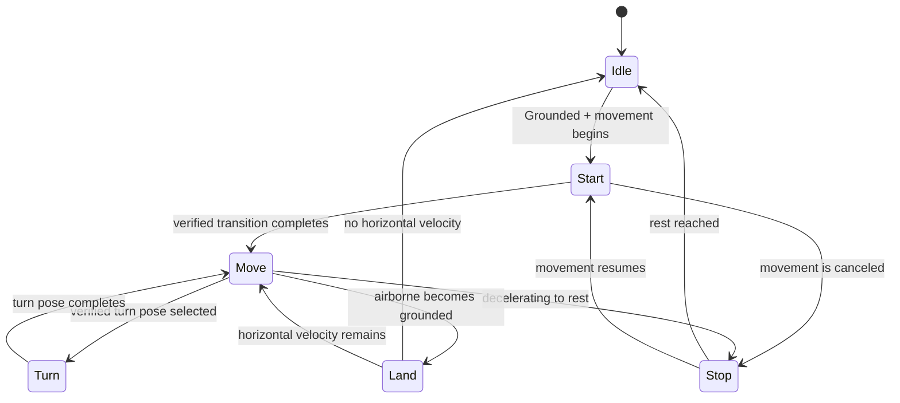

# PLAN-20261026-004：MHWI 基础移动过渡动画

- 状态：partial，完成六候选读回与移动事实数据层；ABP过渡未接入
- 日期：2026-10-26
- 用户需求：完成 R28 剩余基础移动工作；先以原始资源取证，再规划状态转换与过渡动画接入。
- 关联模块 / 接口 / 问题：R28、R-COMBAT-012；`UMHWIAnimInstance`、`ABP_MHWI_Hunter`、`BS_MHWI_Drawn`、`BS_MHWI_Sheathed`
- 实施记录：[B19交接](../Changes/CHG-20261027-001-mhwi-animation-coverage.md)
- 证据：[R28/R30 补充取证](../Reference/MHWI-R28-R30-Evidence-20261026.md)、[源保真审计](../Reference/MHWI-Source-Fidelity-Audit.md)

## 现状与目标

正式基础移动已采用合格源采样库：持刀 idle/walk/run 当前落在 `w03_00_001` 与 `w03_00_004`，纳刀 idle/walk/run 为 `co00_00_001`、`co00_00_203`、`co00_00_090`。两张 BlendSpace 只按 Speed 混合；持刀 walk/run 共用同一源 Sequence。`ABP_MHWI_Hunter` 由 `UMHWIAnimInstance` 驱动，暴露 Speed、Direction、bSheathed；角色移动由 CharacterMovement 驱动，基础循环强制 REF_POSE 锁根。

从原 `w03_00.lmt` 已读取候选 005/006/007/008/014/015 的帧数、原始 header translation 和轨道数，见取证报告。候选动画还没有纳入 NativeFidelity 资格清单；其状态语义、与角色移动 Action 的对应、原版速度阈值尚未独立闭合。180/420 cm/s、RateScale 与现有混合时长均保留为项目设置。

目标是在不改变角色移动物理、战斗动作路由和输入语义的前提下，为已有基础循环补上经核验的起步、停步、转向和落地表现。若某段候选不能通过源采样/姿态资格或无法确认视觉语义，则先保留既有 BlendSpace 路径，不接入该段。

## 范围与验收标准

- 先验证候选序列的 Skeleton、225 骨、原帧时长、根轨迹和 FBX 导入一致性，并对照源 pose 预览确认用途；只把证据通过的片段纳入正式引用。
- 在 ABP 中增加 Ground Locomotion 状态路由：静止、移动 BlendSpace、经证实的移动起始/停止/转向与落地片段；转换可被新输入、动作 Montage 和空中状态安全打断。
- 持刀/纳刀 BlendSpace、基础 DA 六字段、CharacterMovement 物理、当前 180/420 项目速度、REF_POSE 锁根、Montage DefaultSlot 和武器动画事件维持现状。
- 地面起步/停步/转向/落地场景不出现状态卡住、切换重复触发或动作 Montage 被基础状态覆盖；起步/停车姿态与位移同步，静止不会播放移动循环。
- 报告逐段注明“源资源事实”“项目状态策略”“用户运行结果”。除非取得原作动作绑定/运行对照，不以本方案结果宣称原版阈值或全方向地形还原。

## 技术方案

1. **片段资格与语义分离。** 使用 `Scripts/MHWI/audit_r28_r30_evidence.py` 固定来源；将候选逐个纳入 `native_animation_source.py` 的显式导出清单，执行源 pose / FBX / Skeleton / 时长核验。用源帧预览逐项确认起始姿态、终止姿态、根轨迹与实际可见动作。Motion 编号不直接作为语义。
2. **由 AnimInstance 提供状态输入。** 在 `UMHWIAnimInstance::NativeUpdateAnimation` 从实际 Character、CharacterMovement 和 `bSheathed` 生成 `Speed`、`Direction`、地面/空中、加速/减速、局部转向方向等动画变量。动画变量只描述当前移动事实，不驱动移动速度或角色旋转。
3. **以 ABP 状态机编排过渡。** 在 `/Game/MHWI/Blueprints/ABP_MHWI_Hunter` 增加 Ground Locomotion 状态机。Idle/Move 使用现有两张 BlendSpace；经资格核验的 start/stop/turn/land 使用单次播放状态。转移由 grounded、速度/加速度事实及一次性状态完成条件触发，优先级为受击/战斗 Montage > 空中/落地专用态 > 移动过渡 > BlendSpace。现有 DefaultSlot 仍在基础姿态之后消费战斗动作。
4. **阈值与方向作为项目校准数据。** 原作状态消费者未解码的阈值不写成原版事实。初始项目门限只在 ABP/AnimInstance 可追踪的配置位置维护，带注释和单位；通过走、跑、反向、侧向、快速反复起停等真实 PIE 录像校准。不得同步改 CharacterMovement 的速度、转向预算或输入映射。
5. **落地边界。** 使用 CharacterMovement 的落地/地面事实进入 Land 状态，完成或再次离地后回到当前方向 BlendSpace。斜坡、墙面、攀爬、滑坡、骑乘等归 R26，不塞进 R28 的地面状态机。

图示是项目播放状态，不是原版 FSM 复刻；实现前片段资格阶段可以把未证实的 Start/Turn/Land 分支留空。

## 接口与数据迁移

| 接口 ID / 路径 | 当前行为/值 | 目标行为/值 | 调用方/蓝图影响 | 迁移顺序 |
| --- | --- | --- | --- | --- |
| `UMHWIAnimInstance::Speed/Direction/bSheathed` | 提供平面速度、局部方向和拔纳刀状态 | 补充 grounded、加减速及转向离散量；不改已有字段含义 | `ABP_MHWI_Hunter` 新状态机读取 | 先加只读变量，再连接 ABP |
| `/Game/MHWI/Animations/NativeFidelity/LongSword/A_w03_00_00X` | 005/006/007/008/014/015 未合格导入 | 逐段核验后按实际语义接入；未通过者不引用 | `ABP_MHWI_Hunter` | 资格报告 → 资产导入 → 状态机引用 |
| `BS_MHWI_Drawn/Sheathed` 与 `DA_MHWI_LongSword` | 六个合格循环样本/字段已迁移 | 保持现路径、样本和参数 | 现有动作消费不变 | 全程不覆盖 |

## 实施步骤与依赖

1. 基于 B18 报告为候选片段制作源采样/FBX/UE 资格记录；确认项目已识别原 Skeleton 与 NativeFidelity 同路径导入规则。
2. 仅导入通过资格核验的片段，读回资产路径、帧数、Skeleton、Root Motion/Root Lock 与来源哈希。
3. 增加 AnimInstance 移动事实变量并读回蓝图反射值；禁止在 AnimInstance 中反向修改 Movement。
4. 在 ABP 增加状态机和经过确认的片段。使用资产定向备份，不运行全量 author 脚本重建 DA/Montage。
5. 编译、重新打开资产读回 Graph/引用/状态条件，最后在用户控制的 PIE 中记录动作视频和状态日志。

## 验证计划

| 场景 | 方法/命令 | 期望结果 | 覆盖边界 |
| --- | --- | --- | --- |
| 固定源动作与骨架 | `python Scripts/MHWI/audit_r28_r30_evidence.py` 加候选专用 NativeFidelity 源/FBX 核验 | LMT 指纹稳定；通过的片段 225 骨、时长/根/来源一致；未通过者保持未引用 | 静态资源，不证明语义映射 |
| UE 动画图读回 | UE-MCP 只读检查 ABP 状态、Sequence、Slot 顺序；有 C++ 变量变化时按 5.8 完整构建 | 新图可编译、槽层级和已有 BlendSpace 保持 | 不等于真实移动体验 |
| 地面移动 PIE | 用户在训练图录像：静止→慢/快移动、前/侧/后向起停、急转、连续快速重启 | 无卡状态/重复过渡；停止后回 Idle；动画脚步与胶囊移动可接受 | 当前项目参数，不与原作逐帧对照 |
| 动作/落地打断 | 起步/转向中触发战斗动作；从短落差及跳跃着地 | Montage 优先，落地只触发一次，角色再移动能返回 BlendSpace | 不覆盖斜坡/墙/复杂地形 |

## 风险与回退

- Motion 编号语义未闭合；通过骨姿态与源/角色对照后再命名，禁止靠轨迹方向猜“起步/转身”。
- 引入状态机可能改变 Montage 混合顺序；保存 ABP 与动画资产快照，保留原 AnimGraph 分支可直接回退。
- 起停阈值与转向门限是适配，必须放在有单位的配置点，不能写进原生数据表字段。
- 回退时恢复 ABP 和被改动动画资产快照，删除新增但无引用的 NativeFidelity 片段可选；不恢复/覆盖用户已有 DA 修改。

## 文档同步清单

完成实现后更新：`Docs/Systems/MHWI-LongSword.md`、R28 台账与 `R-COMBAT-012` 已知问题、新增 CHG 与 `Docs/Changes/README.md`。若接口反射变化，再更新 `Docs/Interfaces.md` 和 `Reference/modules.json`。
