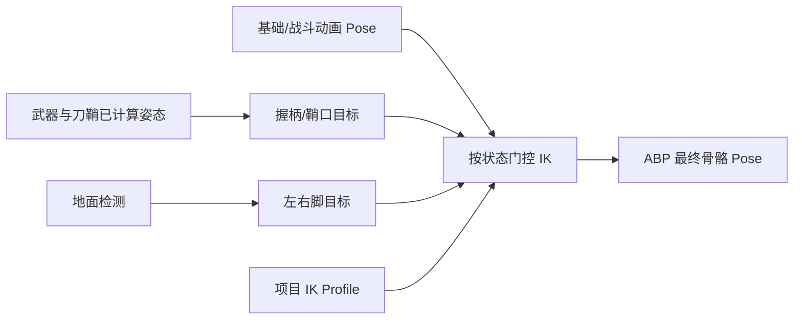

# PLAN-20261026-005：MHWI 武器装配与四链 IK

- 状态：partial，完成选择覆盖与IK数据层；Profile资产和ABP节点未落地
- 日期：2026-10-26
- 用户需求：完成 R30 装配/IK 取证并形成可实施方案，厘清已实现的武器内部动画与尚未实现的 IK 消费。
- 关联模块 / 接口 / 问题：R30、R-ANIM-007；`FMHWIWeaponAttachmentRuntime`、`UMHWIAnimInstance`、`ABP_MHWI_Hunter`
- 实施记录：[B19交接](../Changes/CHG-20261027-001-mhwi-animation-coverage.md)
- 证据：[R28/R30 补充取证](../Reference/MHWI-R28-R30-Evidence-20261026.md)、[武器交接拟合](../Reference/MHWI-Weapon-Transfer-Fitting.md)、[B17 原生消费者取证](../Reference/MHWI-Outstanding-Evidence-20261026.md)

## 现状与目标

已实现的是**武器自身动画轨道**：`wg03_00` 的六条内部太刀动画已进入 Moveset，角色按源事件切换 WeaponMesh 的 SingleNode 播放。整把刀/刀鞘位置另由 `FMHWIWeaponAttachmentRuntime` 处理，使用右/左手 socket、掌心和鞘口材料点、模型专属蒙皮权重、0.7比例与项目交接窗口；这些不是原生 IK solver。

原游戏 `hm/common/ik/` 四条链已映射到 `rig-bind.json` 的连续骨链：双臂 6–8/10–12，双脚 14–16/18–20；IKCTRL 12 槽和四个非空链路径、运行时逐槽虚调用已有固定版本静态证据。项目 ABP 当前无 IK 节点，`hm_common.ctm` 仍未解码，solver 的矩阵/坐标与权重等字段语义未知。

目标是在不改写已经工作的武器内部动作与现有交接逻辑的基础上，为当前交付猎人实现可开关、可量测的 UE 项目双臂握持/双脚接地 IK 层。该实现是从原链布局出发的**项目 IK 适配**，不是原生算法移植；未知的原生极向、限位和矩阵数值保留在原始证据旁，不填入目标配置。

## 范围与验收标准

- 在 UE Animation Blueprint 末端姿态流程上消费四条源链映射；清楚标注每个 IK 输入为世界空间或 SkeletalMesh Component Space，并在接口边界显式转换。
- 手臂目标来自当前刀/鞘的实际材料接触点；脚目标来自实际地面检测。动画 Montage 默认抑制 IK，只有明确的待机/走跑保持或交接窗口启用，避免修改攻击姿态。
- 游戏线程只采集目标并将数值复制到 AnimInstance/动画代理；动画线程不直接访问 Actor/Component。若当前组件附着顺序造成一帧滞后，先验证并采用同一基姿态计算目标的方案，不能用每帧累积 Transform 修正掩盖。
- 项目拟合参数集中放在独立 IK Profile/数据资产；不复用或重写原 `.ik` 未知字段，不把 0.7、0.16s 或测试阈值称为原版数值。
- 静止、移动、纳刀、拔刀、特殊纳刀和打断/Montage 切换没有目标跳变、手掌脱离、脚踝抖动或逐帧累积漂移；多视角有明确误差和穿插记录。

## 技术方案

1. **保留武器组件作为手部目标的可见来源。** 继续由 `FMHWIWeaponAttachmentRuntime` 管理 WeaponMesh/ScabbardMesh 的挂接与交接；内部武器动画继续按现有源 MotionNo 事件播放。R30 不在 IK 节点内部重新播放武器 Sequence。
2. **建立角色专用 IK Profile。** 增加 `DA_MHWI_EquipmentIK_Profile`（或轻量结构）保存四条链的 root/mid/end 骨名、每条链的 project solver、pole/bend hint、目标来源、ComponentSpace 目标偏移、Alpha 曲线与地面探测参数。骨名初值对应 `bone_006/007/008`、`bone_010/011/012`、`bone_014/015/016`、`bone_018/019/020`；只能依据已核验的项目 Skeleton，不能写通用骨名猜解。
3. **以 UE TwoBoneIK 节点实现四条近似链。** 在 `/Game/MHWI/Blueprints/ABP_MHWI_Hunter` 基础 Pose 后串接四组 TwoBoneIK；若四组串接无法保持动画相位或造成明显手脚相互干扰，再评估 Control Rig/FBIK，不预先新增第三方 solver。该算法只实现项目的双骨约束，不代表原游戏虚方法。
4. **同一坐标系内提供目标。** `UMHWIAnimInstance::NativeUpdateAnimation` 或安全的 PreUpdate 阶段，在游戏线程采集刀柄握点、鞘口材料点和脚底命中点，再转换成 Mesh Component Space 的值快照。AnimGraph 使用该快照，不在动画线程访问 `AMHWICharacter` 或组件。先以静止、移动、拔刀交接验证目标延迟；必要时将握点目标从当前基姿态和武器 local fit 计算，避免依赖“上一帧已更新的 WeaponMesh”形成循环或一帧漂移。
5. **分层门控。** 先只在基础待机/移动且非 combat montage 时打开手臂约束；特殊纳刀启用现有双掌握持目标，拔刀/纳刀仅在已存在项目交接时间内淡入/淡出。脚链只在 grounded 下接受 floor trace，在 jumping/airborne/attack montage 禁用或按显式项目规则降低 Alpha。禁止从未知 IKCTRL 行推断原生 Alpha/触发条件。
6. **不混淆三种数据。** 源 `.ik` 链布局、`wg03_00` 武器内部骨运动、项目装备/手脚目标 Profile 分开保存。CTM 原件继续只作来源证据，未能解码前不当作挂接矩阵。

## 接口与数据迁移

| 接口 ID / 路径 | 当前行为/值 | 目标行为/值 | 调用方/蓝图影响 | 迁移顺序 |
| --- | --- | --- | --- | --- |
| `FMHWIWeaponAttachmentRuntime::Update` | 在 Hunter 更新后挂接刀/鞘并锚定握点；无骨骼 IK 输出 | 保持职责；向 AnimInstance 提供本帧的项目握点/鞘口目标快照，不让组件 helper 直接修改角色骨骼 | `AMHWICharacter` → `UMHWIAnimInstance` | 先目标采集，再接 AnimGraph |
| `UMHWIAnimInstance` | Speed/Direction/bSheathed；不读取 IK | 新增角色 IK Profile、目标 ComponentSpace 值、Arm/Foot Alpha 和状态门控输入 | `ABP_MHWI_Hunter` | 先反射/线程安全，再引用资产 |
| `/Game/MHWI/Blueprints/ABP_MHWI_Hunter` | 无 IK 节点；默认动画姿态消费现有 BlendSpace/Montage | 基 Pose 后按 Profile 接四链 TwoBoneIK，明确 Slot 次序及 Montage Alpha | 现有角色 AnimClass 不变 | 先双手持刀测试，再足部 |
| 原资源 `hm/common/ik/*.ik` / `hm.ikctrl` | 只读证据，无运行消费者 | 继续作为索引/链结构证据，不直接导入未知数值 | 离线审计脚本与报告 | 不写回原资源 |

## 实施步骤与依赖

1. 以本轮 B18 报告与 `audit_r28_r30_evidence.py` 为基线；查清角色实际 SkeletalMesh 的骨名和 IK Profile 读回路径。
2. 在独立 Profile 中登记四条链、目标坐标系与项目拟合值；完整资产路径及父类/属性经 MCP 读回。先记录当前 ABP、武器附着和用户改动 DA 的备份哈希。
3. 在 C++ AnimInstance 中加入只读目标与 Alpha 属性；按游戏线程采样、AnimInstance Proxy/PreUpdate 线程规则传递，不在 `Evaluate_AnyThread` 解引用 UObject。
4. ABP 先启用单一双手保持姿态的左右臂节点，排查武器附件更新与 AnimGraph 时序；稳定后再加入普通持刀走跑，最后加入双脚接地节点。
5. 加入状态/动作 Alpha 门控：空中、动作 Montage、死亡/输入阻断与组件失效时关闭或清零目标；重入后从实际当前姿态恢复，不累积上一次执行缓存。
6. 构建与反射/蓝图编译通过后，重开项目读取 ABP 节点和 Profile；用户 PIE 验收后再调整项目拟合参数并记录误差。

## 验证计划

| 场景 | 方法/命令 | 期望结果 | 覆盖边界 |
| --- | --- | --- | --- |
| 原生来源与骨链 | `python Scripts/MHWI/audit_r28_r30_evidence.py` | 8/8 资源与已固定归档哈希匹配；四链映射到项目 Skeleton 连续父子骨 | 只证来源/映射，不证求解器语义 |
| C++/反射与 ABP | UE 5.8 Editor 完整构建；MCP 读回 AnimInstance 属性、Profile 和 ABP IK 节点顺序 | 编译/蓝图通过；AnimGraph 只消费复制后的目标值 | 不代表视觉贴合 |
| 双手持刀多视角 | 用户 PIE 静止/走跑/转身/拔纳刀/特殊纳刀；0/45/90/180 度录像，采样右掌握柄、左掌握柄/鞘口距离 | Profile 锁定姿态目标误差建议 ≤2 cm，无单帧跳变；阈值标为项目验收 | 不宣称原生误差或所有武器型号 |
| 双脚接地 | 平地静止/走停、缓坡与跨小高差 PIE 录像，检查脚底偏差和滑移 | 着地足跟/趾误差建议 ≤2 cm；离地及时关闭 IK；阈值为项目验收 | 复杂攀爬/墙行/滑坡归 R26 |
| 打断和动作姿态 | 在持刀/纳刀及攻击 Montage 间切换、受击、死亡、PIE停止再开始 | IK Alpha 清理/恢复正确，不盖住打击 Montage，无悬空旧目标 | 不验证原生 FSM/控制器的逐槽条件 |

## 风险与回退

- 原 solver 的坐标、pole、限位和 CTM 语义尚未解码；本方案只承诺当前模型上的可量测项目拟合。若将来要宣称原版还原，必须新开静态/运行取证并重新校验源数值。
- AnimInstance 更新与 SkeletalMesh/WeaponMesh 组件更新可能形成一帧目标时差。若接触点抖动，先修目标生产顺序，不增加每帧反向纠偏。
- TwoBoneIK 逐链求解的结果取决于基础 pose 与执行顺序；特殊攻击中默认关闭，步态/武器模型不同需配置独立 Alpha/目标。
- 回退时恢复 `ABP_MHWI_Hunter`、IK Profile 与新增 AnimInstance 字段，不回退已有 weapon motion 或 `FMHWIWeaponAttachmentRuntime` 的修复，也不覆盖当前用户 DA 修改。

## 文档同步清单

完成实现后更新：`Docs/Systems/MHWI-LongSword.md`、R30 台账、`R-ANIM-007` 已知问题、新增 CHG 和 `Docs/Changes/README.md`。若 UPROPERTY/蓝图可见接口变化，同步更新 `Docs/Interfaces.md` 与 `Reference/modules.json`。
