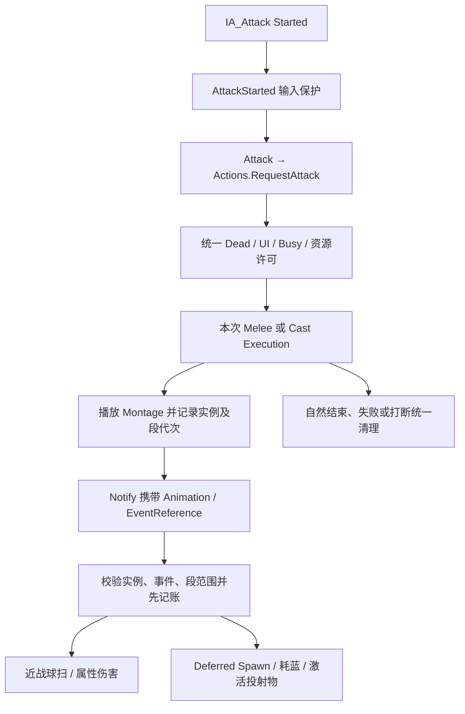

# 战斗、动画通知与敌人 AI

源码入口：[CharacterActionComponent.cpp](../../Source/IntroCpp/Actions/CharacterActionComponent.cpp)、[CharacterActionEffects.cpp](../../Source/IntroCpp/Actions/CharacterActionEffects.cpp)、[MyPlayerCharacter.cpp](../../Source/IntroCpp/MyPlayerCharacter.cpp)、[EnemyBase.cpp](../../Source/IntroCpp/EnemyBase.cpp)、[EnemyAIController.cpp](../../Source/IntroCpp/EnemyAIController.cpp)。关联接口：`ACTION-*`、`ATTR-*`、`COMBAT-*`、`AI-*`。

2026-10-19 已实施统一调度、独立执行上下文、物品来源预约、动画身份校验和样本窗口；旧攻击/连击 Timer 不再是玩家动作权威。当日完整编译、10项自动化及真实PIE的41项断言通过，详见 [实施记录](../Changes/CHG-20261019-005-character-actions-implementation.md)。2026-10-20 已制作并保存 [Ninja动画替换](Ninja-Animation-Configuration.md)，按用户要求不做完工后验证；旧证据不覆盖新资源。MM尚未启用。

## 属性与伤害入口

[UAttributeComponent](../../Source/IntroCpp/AttributeComponent.h) 持有 HP/MP、死亡和恢复计时。默认 MaxHealth=100、MaxMana=50、HealthRegenPerSecond=0、ManaRegenPerSecond=2、受伤恢复延迟 3 秒；BeginPlay 会把当前值重置为最大值并置存活。

伤害源直接查找目标 AttributeComponent 并调用 ApplyDamage。它不是当前项目中统一接入 UE TakeDamage/GAS 的证明。ApplyDamage 更新血量后先发 OnHealthChanged；致死时发 OnCharacterDeath，否则正伤害发 OnDamaged。致死分支不再发 OnDamaged。UseMana 仍为 void、会 clamp；新 `TrySpendMana(float) -> bool` 在游戏线程先检查存活、有限非负成本和余额，失败不改变 MP，成功扣除后可能同步广播属性委托。

物品提交使用 `BeginNotificationBatch/EndNotificationBatch` 延后内置 HP/MP 变化通知，先扣原来源、更新统计，再让属性和背包监听者观察已提交状态。此机制不保证任意自定义 ItemAction 的外部副作用可回滚。

## 玩家攻击流程

关键职责：

| 接口/对象 | 当前职责与依赖 |
| --- | --- |
| UCharacterActionComponent | 一个前台动作；统一请求许可、RunId、段代次、缓冲、冷却、移动快照及清理 |
| Melee / Cast / UseItem Execution | 每次请求创建 UObject 上下文，由组件以 GC 可见强引用持有；执行效果时再次校验当前上下文 |
| EquipWeapon / UnequipWeapon | 通过 CanChangeEquipment 后更新角色武器、外观与动画类型，装备时预加载投射物/连击引用；不等于移动背包物品 |
| Attack / UseHeldItem | 兼容启动入口，分别转发 RequestAttack / RequestUseItem(true, SelectedQuickSlotIndex) |
| FireFromHand / OnMeleeHitNotify / OnUseItemAnimFinished | 保留旧符号以便迁移；无身份调用仅记录警告，不再直接结算 |
| ApplyCast | 快照成本、伤害覆盖、投射物类和 Socket；Deferred Spawn 设置 Owner/Instigator、标准火球伤害与速度，扣蓝后再激活；资源不足或类未就绪不发射 |
| AAFireballProjectile | 自带飞行、碰撞、Damage、发射/命中特效、延迟销毁；bHasHit 防止重复处理命中 |
| AAFireballSpawner | 场景生成器，支持单次/定时发射与散射；与角色发射同用投射物类 |

`RequestAttack/RequestUseItem` 返回 Started、Buffered 或 Rejected，附 Failure、RunId；Started 表示已接受启动，不表示命中、扣蓝或消耗物品成功。背包 `UseItem/UseSelectedQuickSlot` 对玩家的 bool 返回也仅表示请求被接受；无 Montage 的物品可在请求内即时提交或失败。

动作期间拒绝换装、打开背包与物品请求；当前实现采用**全背包及快捷栏写入锁**，添加、移动、排序、丢弃、选槽等公共写接口都拒绝修改。物品来源保存容器、索引、ItemID、数量和全局修改版本，仅从原容器扣一件；快捷栏仍是独立数组，不自动同步扣同 ID 背包物品。完整边界见 [背包系统](Inventory.md)。

施法先检查 MP，提交帧重新校验并扣蓝；尚未实现独立 MP 预约令牌。`WeaponDamageOverride != 0` 现在写入标准 `AAFireballProjectile::Damage`，自定义投射物类不因此自动获得通用伤害接口。近战在本次执行首次有效命中事件支付一次成本，空挥也算有效提交；同一连击执行的后续命中不重复支付。

## 连击契约

[UComboAttackData](../../Source/IntroCpp/ComboAttackData.h) 仍作为兼容配置，提供 Montage、Hits 与循环标记。每段包括 SectionName、伤害、球扫、击退、HitWindowStart/End 与可选 SubHits；旧 ComboResetTime 不再驱动角色 Timer 重置。

- CurrentComboIndex 是 **0 基索引**；Blueprint 事件也是此索引，UI 显示第几段时自行换算。
- 连续链共享 RunId，每次进入一段增加 SegmentGeneration，并**重新播放同一 Montage 的新实例**；不依赖同一实例跳段来区分迟到通知。旧实例和旧段回调不能清理新段。
- 攻击 Pressed 最多保留一条缓冲。窗口前默认有效期0.15世界秒，连点刷新同一条，过期丢弃；窗口内立即登记下一段意图，之后不再受早按TTL影响。至窗口末尾且本段最后命中已到达才切段；跨帧越过整个窗口也做区间判断。333ms帧间隔回归通过。末段不循环时清除排队，不自动重开首段。
- 窗口优先读取 Montage 上 `UAnimNotifyState_ActionWindow` 的 Chain 范围；未配置时读取旧 HitWindowStart/End。范围按相对本段的**动画秒数**处理，跟随播放速度；不是世界 Timer。
- 启动时收集本段全部必需事件索引；缺少事件拒绝启动，非近战提交必须恰好一个，非空 SubHits 数量必须匹配本段近战通知数。进入下一段及自然结束必须收齐事件并有成功提交，否则以 MissingEvent 失败。
- 每个通知索引每段最多结算一次；同段不同通知可分别造成伤害，SubHits 不再循环回零。沿用单目标 Pawn 通道球扫；不要让 BP_OnMeleeAttackHit 表现事件再次扣血。
- 当前长剑 `/Game/MyStuff/Model/Robot/M_LongSwordAttack` 使用 Ninja ComboA1..4 重定向片段、Combo01..04和5次近战通知，分布2/1/1/1；八个Chain/Cancel窗口按新片段时长分别配置，见 [时序表](Ninja-Animation-Configuration.md)。ComboData同步SubHits与倍率，保留原每段累计配置伤害15/20/30/50。2026-10-19的四段六命中PIE证据属于旧资产；本轮按用户要求未做完工验证，视觉混合与通知效果待后续获准再检查。

## 生命周期、取消和动画快照

阶段为 Idle / Windup / Active / Recovery；终止理由为 Completed、Cancelled、Interrupted、Failed、Dead、OwnerEnded。完成函数先失效实例和当前执行，再停止 Montage、更新兼容镜像和广播；效果派发期间的死亡/结束先延后清理，避免在提交栈内重入。自然 BlendOut 关闭命中与衔接，Ended 才检查完整提交并结束；异常超时看门狗只失败清理，不补发效果。

`TryCancelAction(int64 RunId) -> bool` 仅接受当前 RunId，且要求当前播放位置位于显式 Cancel 窗口；过期身份、无窗口、BlendOut 或派发期间返回 false。`Interrupt(Reason) -> void` 是强制路径，不检查自愿取消窗口；死亡和 EndPlay 走统一终止，已经提交的效果不退款。OwnerEnded 抑制面向外部的结束广播并解绑死亡委托。

`GetSnapshot()` 返回 RunId、Kind、Phase、0 基 ComboIndex、SegmentGeneration、**本段** bCommitted、MoveScale、bAllowJump 的副本。无动作默认可移动/跳跃；UI、死亡或 owner 结束另强制锁定。Character 移动和跳跃读取该策略；角色 `bIsAttacking/bIsUsingItem` 与 AnimInstance 的攻击字段仅作兼容镜像，不是另一套调度权威。攻击/使用默认禁止主动移动和跳跃，允许行为可由动作定义配置；独立 FacingPolicy 尚未实现。

## 动画通知接口

| 通知类 | Owner 及调用 | 资产必须保证 |
| --- | --- | --- |
| [UAnimNotify_Fireball](../../Source/IntroCpp/AnimNotify_Fireball.cpp) | MyPlayerCharacter.Actions → HandleNotify(CastCommit) | Montage 内恰好一个提交事件 |
| [UAnimNotify_MeleeHit](../../Source/IntroCpp/AnimNotify_MeleeHit.cpp) | MyPlayerCharacter.Actions → HandleNotify(MeleeHit) | 每个命中显式通知，与非空 SubHits 数量/顺序匹配 |
| [UAnimNotify_UseItemComplete](../../Source/IntroCpp/AnimNotify_UseItemComplete.cpp) | MyPlayerCharacter.Actions → HandleNotify(ItemCommit) | Montage 内恰好一个提交事件；中断前后消费分别验证 |
| [UAnimNotifyState_ActionWindow](../../Source/IntroCpp/Actions/AnimNotifyState_ActionWindow.h) | 动作组件读取 Chain / Cancel 时间范围 | 作为时间标记，不通过 NotifyBegin/End 回调持有运行状态；每段每类建议一个窗口 |
| [UAnimNotify_EnemyAttack](../../Source/IntroCpp/AnimNotify_EnemyAttack.cpp) | EnemyBase → OnAttackAnimNotify | 只在伤害实际发生帧触发 |

HandleNotify 要求正确 Mesh、Montage、`FAnimNotifyMontageInstanceContext::MontageInstanceID`、当前段范围、实际事件地址及预期索引，登记事件后才执行效果。普通 Sequence 的通知、无上下文调用、旧实例和重复事件不能结算。BlueprintImplementableEvent 仍是表现扩展点；旧蓝图无参效果调用需审计并迁移，不能依靠旧函数仍存在来获得伤害权限。

## 动作定义与 Motion Matching 边界

[UCharacterActionDefinition](../../Source/IntroCpp/Actions/CharacterActionDefinition.h) 可由 WeaponData/ConsumableData 引用，配置 ActionId、Montage、PlayRate、MoveScale、bAllowJump、InputBufferSeconds、MaximumActiveSeconds；未分配时继续读取已有武器、消耗品和连击配置。类型已实现不代表 `/Game/Data/Actions` 中的样本 DataAsset 已创建或完成赋值。

[FLocomotionAnimContext](../../Source/IntroCpp/Actions/LocomotionAnimContext.h) 由 [MyAnimInstance.cpp](../../Source/IntroCpp/MyAnimInstance.cpp) 在游戏线程更新，包含世界空间 Velocity/Acceleration、按动作 MoveScale 限制的 DesiredVelocity、实际 Facing、Stance、bGrounded 和 Action 快照，图表消费者只读。单位为 cm、cm/s、cm/s²；这不是完整轨迹预测器或已接入的 Pose Search 查询。

**Motion Matching 尚未启用到正式角色。** 2026-10-19的 [MM审计](../Plans/MM-P5-Audit-20261019.md) 发现原走跑Root没有可用平移，形成 [资源清单](../Plans/MM-RootMotion-Resource-Checklist.md)。2026-10-20用户提供ARPG_Ninja资源，本轮只将26条待机、IPC移动与动作重定向到YBot并接入原BlendSpace/Montage；Rootmotion版本尚未完成MM适用性专项审计，未新建Schema/Database或更换ABP图。资源到位不等于MM已启用。

火球Montage现用Ninja左手Throw_A作为施法手势，唯一提交为约0.183333动画秒；火杖WeaponFireSocketName=LeftHand。喝药因新包无对应资源继续沿用M_Drink。后续按用户要求，三个移动BlendSpace已切Rootmotion版本，ABP_Move.RootMotionMode=RootMotionFromEverything；Speed/Direction由受许可的DesiredVelocity及移动输入力度驱动，CharacterMovement消费动画根轨迹处理胶囊位移、碰撞和重力。四段攻击也已启用根运动，MoveScale=0限制移动输入及底层走跑意图，不取消攻击本身的根位移。完整映射、公式与未验证项见 [Ninja配置](Ninja-Animation-Configuration.md)、[Root Motion变更](../Changes/CHG-20261020-002-ninja-root-motion.md)。本轮未做完工后验证。

用户随后反馈走跑不移动、衔接生硬。静态定位到LayeredBoneBlend上层先以零根权重请求共享PoseCache，缓存等姿态权重保留首个请求。已设bUpdateBasePoseFirst=true保留底层根运动，并给三个BS设置0.10秒方向/0.16秒速度输入平滑、8/s样本权重过渡。修改已保存、按用户要求未运行验收，见 [缓存修复记录](../Changes/CHG-20261020-003-locomotion-root-cache-fix.md)。

## 自定义敌人

UEnemyData 管理血量、伤害、速度、视野、巡逻、攻击范围/冷却、容差、Montage、网格和音效。EnemyBase 持有 AttributeComp、AttackOrigin、目标、攻击/死亡状态；BeginPlay 应用配置并绑定属性事件。

EnemyAIController 的 Tick 状态机为 Patrol → Chase → Attack，任意状态可进入 Dead。感知成功时只要目标带 AttributeComponent 就可能被选中，当前没有完整阵营过滤；追击丢失用 ChaseLeewayTime，退出攻击用范围缓冲与 ExitAttackRangeGraceTime。

PerformAttack 启动动画；OnAttackAnimNotify 才调用球扫伤害。Die 会停运动/动画、清目标、关碰撞、按动画/回退时长延迟销毁。收到非致死伤害可打断攻击并播放受击反馈。

当前 Enemy_Dummy 蓝图的 **AIControllerClass 为 null**；源码 OnPossess 又在运行阶段调用 CreateDefaultSubobject。不能将“编辑器能启动”视为“敌人感知、导航、攻击完整通过”。启用或修复 AI 前先处理 [R-AI-001/002](../Known-Issues.md)，再进行可见、丢失、超距、死亡等运行验证。

## 模板玩法边界

`Variant_Shooter` 用 ShooterCharacter、ShooterWeapon、IShooterWeaponHolder、ShooterNPC 与 StateTree 工具；`Variant_Horror` 有 HorrorCharacter 的冲刺等逻辑。这些代码与自定义 Inventory/Combo 不是同一个入口。修改 StateTree API 仍需编译它们，但不应顺便把自定义敌人的 Tick AI 改写为 StateTree。
