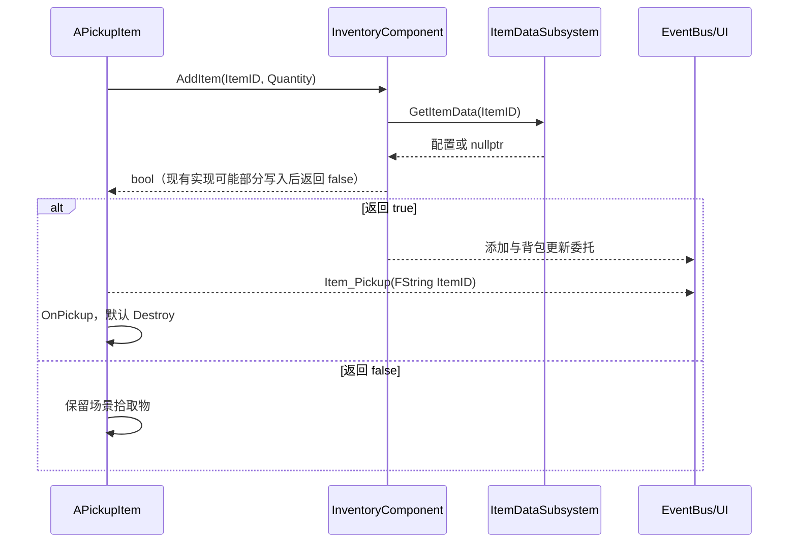

# 物品、背包、装备与快捷栏

源码入口：[InventoryComponent.h](../../Source/IntroCpp/InventoryComponent.h)、[实现](../../Source/IntroCpp/InventoryComponent.cpp)、[ItemDataSubsystem.cpp](../../Source/IntroCpp/ItemDataSubsystem.cpp)。接口索引：`ITEM-*`、`INV-*`，见 [接口契约](../Interfaces.md)。

## 数据模型

`FItemInstance` 只有 `FName ItemID` 与 `int32 Quantity`。`ItemID==NAME_None` 或 `Quantity<=0` 就是空槽；它没有独立实例 GUID、耐久、附魔或存档版本字段。

| 类型 | 职责 |
| --- | --- |
| [UItemDataBase](../../Source/IntroCpp/ItemDataBase.h) | UPrimaryDataAsset；名称、类型、稀有度、图标、外观、拾取 Actor 类、Action 类、堆叠、重量及使用/丢弃开关 |
| [UConsumableData](../../Source/IntroCpp/ConsumableData.h) | HealthRestore、ManaRestore、UseMontage；Buff 字段存在，但未见完整 Buff 运行系统 |
| [UWeaponData](../../Source/IntroCpp/WeaponData.h) | 远近程、投射物类、耗蓝、冷却、动画类型、插槽、模型、连击配置 |
| [UItemDataSubsystem](../../Source/IntroCpp/ItemDataSubsystem.h) | ItemID → 软引用映射与已加载对象缓存；查询返回对象或 nullptr |
| [UItemAction](../../Source/IntroCpp/ItemAction.h) | 临时效果对象；初始化配置后执行，返回是否请求消耗 |

ConsumableData 与 WeaponData 已增加可选 `ActionDefinition`，供 [角色动作组件](../../Source/IntroCpp/Actions/CharacterActionComponent.h) 读取动作配置；旧物品数据字段仍保留。以下使用后端描述本轮已实现源码；自动化与 PIE 的实际结果以对应[变更记录](../Changes/README.md)为准，不把接口存在等同于运行验收完成。

扫描先查询 AssetManager 的 `Item`，仅注册表为空才回退递归扫描 `/Game/Data/Items`。扫描会同步加载对象用于注册，不是全程纯懒加载。扫描完成标志会阻止重复扫描；运行时新增物品可显式 RegisterItemData。重复 ItemID 覆盖软引用映射，但不会自动清理已加载缓存。

当前核实的 ItemID：Gold_Coin、Potion_HP、Potion_MP、WP_FireStaff、LongSword。尤其长剑 ID 为 **LongSword**，不可根据资产文件名推断为 WP_LongSword。完整路径与 Action 配置见 [编辑器快照](../Reference/editor-observations.json)。

## 存储与事件

Inventory 是组件私有数组，默认 20 格；QuickSlots 是另一份私有数组，固定 5 格，通过 GetQuickSlot / SetQuickSlot / ClearQuickSlot 访问，保留原 BlueprintReadOnly 反射字段。SelectedQuickSlotIndex 默认 0，装备另由 EquippedSlotIndex 指向背包索引。两份存储各自拥有物品，尚无通用的跨容器迁移事务。

当前拖拽会把整堆数据从 Inventory 搬到 QuickSlots 并清空源槽，或执行交换；不能把 QuickSlots 写成“只引用背包索引”。`UUW_QuickSlot::NativeOnDrop()` 与 `UUW_InventoryUI::HandleQuickSlotDrop()` 对“目标已有物品”的处理不同；前者会尝试 AddItem 归还旧物品，后者交换源槽内容。

数字槽选择仅广播选中变化；角色监听后显示物品或直接 EquipWeapon。UseSelectedQuickSlot 的武器分支也经动作许可后直接装备快捷栏中的武器，不再 AddItem 复制一份到背包。背包装备索引与角色当前武器仍是两种表示，不能假定 EquippedSlotIndex 覆盖快捷栏装备来源；排序、拖拽和装备索引的既有边界仍见[已知问题](../Known-Issues.md)。

使用提交直接修改原容器，不再调用 RemoveItemAt 后重复刷新。每次成功消费先更新数量、非空槽数和背包重量，再发布属性变更、OnItemRemoved、OnItemUsed、必要的 OnQuickSlotChanged 和 OnInventoryUpdated。最后一件清空后，移除/使用事件仍携带提交前保存的 ItemID 与数量 1。其他操作仍可能连续产生多个刷新；刷新次数不能作为消费次数。

## 动作占用与来源预约

玩家的攻击、施法、使用物品共享一个前台动作。动作占用、动作清理或效果派发期间，背包公共写接口统一拒绝写入，包括添加、移除、丢弃、交换、整理、装备、快捷栏选中与内容修改。因此攻击中自动拾取也会被拒绝，场景拾取物按原 AddItem 返回值保留。这是首轮采取的全局保守锁，尚未实现“只锁预约槽、允许其他槽变化”。

`ReserveActionItem` 是动作组件使用的私有原生接口，保存 `bQuickSlot + SlotIndex + ItemID + Quantity + MutationRevision`。MutationRevision 是组件级版本；获准进入的公共写接口会递增它，部分无实际改动的调用也会递增。它不是每槽版本或物品实例 GUID。提交重新核对版本、原槽 ItemID/数量、可使用配置、Owner authority 与存活状态，不能按同 ID 临时换到另一个容器扣除。

`bCommittingActionItem` 额外覆盖效果构造、初始化、执行与全部提交委托，即使拥有者没有动作组件，也不能通过同步回调再次使用或修改库存。动作配置和效果对象在提交期间使用强引用保活；Owner 在效果中被杀死/销毁后停止后续效果，之前已报告成功的效果仍按原来源消费一次。取消发生在提交前不扣物品，提交后打断不回退已发生效果。

## 拾取、丢弃、使用

实际自动拾取在 [APickupItem::OnOverlapBegin](../../Source/IntroCpp/PickupItem.cpp)；MyPlayerCharacter 中的 OnItemPickup 主要是日志和预留，不是另一套已启用的入包逻辑。

DropItem 尝试读取 ItemClass 并生成掉落物，再移除整堆。现有实现即使未生成成功也可能继续移除；不得把它写成“掉落成功后才扣除”。

玩家的 `UseItem(SlotIndex)` 转发为 `Actions.RequestUseItem(false, SlotIndex)`；`UseHeldItem` 与消耗品 `UseSelectedQuickSlot` 转发为快捷栏来源请求。请求先经过统一 Dead / UIBlocked / Busy 等许可，再预约原来源并播放 UseMontage。UseItemComplete 通知经当前动作和 Montage 实例校验后才执行一次提交；旧无身份的角色效果入口不再另行消费。没有动作组件的拥有者使用相同来源校验和提交后端同步执行。

`UseItem` 的 bool 对玩家表示“动作请求已接受”，不保证效果已经生效；没有动作组件的同步路径才表示已经消费。UI 使用按钮先保存 Inventory 弱引用、槽位及源 ItemID/数量，再关闭背包以解除 UIBlocked；关闭委托返回后重新核对来源，才发起使用，避免回调改变选择后误用别的物品。

### 提交结果与事件一致性

私有 `CommitActionItem(Source, Data)` 返回 [FActionItemCommitResult](../../Source/IntroCpp/Actions/CharacterActionTypes.h)，当前由动作执行器读取 IsCommitted() 判定本次是否已消费；它不是新增的 Blueprint 使用入口。

| 字段 | 当前语义 |
| --- | --- |
| `bApplied` | 至少一个 Legacy ItemAction 返回 true；这是效果报告，不是对任意外部副作用的完整检测 |
| `ConsumedQuantity` | 实际从原来源扣除的数量，当前为 0 或 1 |
| `bPartial` | 至少一个效果报告成功，同时存在返回 false 或因 Owner 结束而未执行的后续效果 |
| `IsCommitted()` | ConsumedQuantity > 0；不等同于每个效果都成功 |

提交先加载并初始化全部效果，缺类/抽象类等预检失败时不进入 Execute。任一效果报告成功便消费一次；多个成功效果也只扣一件。全部返回 false 时不扣。没有 Action 的 Consumable 保留默认消费行为，此时 bApplied=false、ConsumedQuantity=1；它不会自动读取恢复值，回血/回蓝仍需配置对应 Action。内置 Heal/RestoreMana 在已有属性组件时保留满血/满蓝也报告成功并消费的行为。

执行效果前开启 AttributeComponent 的 HP/MP 通知批次；数量和统计提交后、库存事件前结束批次。健康值和魔法值已经改变，但 OnHealthChanged / OnManaChanged 延迟到此时发布，使监听者能够读取已提交的源数量。批次以作用域清理兜底，且 flush 期间库存仍禁止重入写入。死亡、受击及自定义效果自己的事件没有一并延迟，不能宣称所有外部事件具有相同事务边界。

### Legacy 扩展边界与验证

UItemAction 的旧 bool 只表达消费请求：自定义 Blueprint/native Execute 返回 false 仍可能已产生外部副作用，无法通用回滚，也不能把 bApplied=false 写成“什么都没有发生”。多效果组合采用部分成功消费一次的策略。初始化约定只读配置，不应在 InitializeFromItemData 内产生玩法效果。旧 Execute 的 SlotIndex 参数没有容器类型；快捷栏请求传入的是快捷栏索引，自定义效果不得据此直接读取 Inventory[SlotIndex] 当作来源，内置恢复效果不读取该索引。

4项[库存动作自动化测试](../../Source/IntroCpp/Tests/InventoryActionTransactionTests.cpp)已实际通过，覆盖两容器同ID来源独立、重复预约、最后一件事件、属性通知读取提交后数量/重入写拒绝、缺类/无效果/来源变化失败及部分成功只扣一次。真实PIE也已验证快捷栏最后一件只扣原来源、背包同ID数量不变、动画前中断与死亡不扣，见 [实施记录](../Changes/CHG-20261019-005-character-actions-implementation.md)。此次后端改动没有修复AddItem部分添加、丢弃生成失败及所有拖拽交换/装备索引问题。

## 新增物品的技术方案落点

1. 普通新物品优先复用已有 DataAsset 子类，分配唯一 ItemID；类型行为变化才考虑新建类。
2. 需要新效果时派生 UItemAction，定义 InitializeFromItemData 与 Execute 的输入、是否消耗和失败副作用；不要重复实现现有效果。
3. 放在扫描目录并核对实际注册；配好 ItemIcon、ItemClass、bCanUse、MaxStackSize、Weight。
4. 武器同时查 [战斗文档](Combat-AI.md)，UI 资产同时查 [绑定文档](UI-Assets.md)。
5. 验证空背包、部分堆叠、满包、超重、仅在快捷栏的物品、最后一件消耗、拖拽目标已占用、装备中排序/丢弃。自动化或手工结果写变更记录。

这是新增方案的推荐顺序，不表示当前实现已经具备上述所有边界保护。已发现的问题见 [Known-Issues](../Known-Issues.md)。
